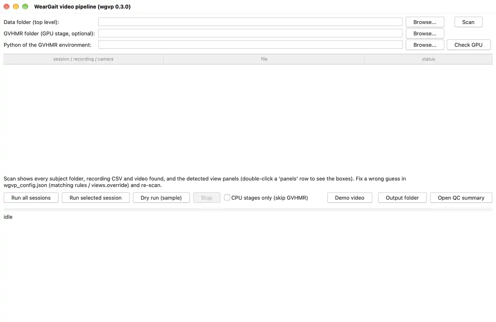

# wgvp - WearGait video-to-pose pipeline

[](https://github.com/mikecredence/wgvp/actions/workflows/ci.yml)

Gait-laboratory video usually shows more than the participant: staff at a desk, a clinician walking alongside,
people passing in the background. The participant is the one wearing the inertial sensors. wgvp uses that fact to
turn a two-camera session video plus its sensor recording into per-frame 3D body poses of the participant alone.

It runs entirely on the data owner's own computer, needs no network, and ships only **pose-level derivatives**
(SMPL-X body parameters, 2D skeleton keypoints without face points, bounding boxes, sync offsets, QC numbers).
No video frame leaves the site. It was built for the [WearGait-PD](https://doi.org/10.7303/syn52470130) session
videos (two camera views tiled into one frame beside the IMU/walkway CSV export), and the folder-matching rules,
sensor column names and task names are all in one editable JSON file, so other labs' layouts are a configuration
change.


*Both camera views of the bundled synthetic session (rendered bodies, no real people). Green is the person the
pipeline chose from the pelvis accelerometer; the co-walker, the seated operator and the bystander stay grey.*

## What it does

For each session video (one file, two views tiled side by side or stacked, unequal sizes and letterboxing are fine):

1. **Finds the two view panels** in the frame (black borders plus the persistent content seam).
2. **Tracks every person in each view** with a 2D pose tracker (CPU).
3. **Picks the subject**: the person whose pelvis up-and-down motion matches the pelvis accelerometer in the
   recording CSV. Seated or standing people do not match however large they are in frame; the two views are matched
   jointly; the subject's exits from a view are recorded as gaps instead of being filled with a bystander.
4. **Syncs** the video to the recording timeline with the same cross-correlation (the video frame of IMU t = 0, with
   a confidence), cross-checked against a sync light if one is visible, a Video Labeler label export if present, and
   an annotation-sheet start frame if present.
5. **Lifts the subject to SMPL-X body parameters** per frame and per view with [GVHMR](https://github.com/zju3dv/GVHMR)
   (the only GPU step), driving the lifter with the subject's own bounding boxes so it follows the right person.
6. **Reconciles the two views** on the IMU timeline, writes a QC record per recording and view, skeleton-only
   thumbnails, and one QC summary page across all sessions.
7. **Merges the two views into one pose per frame** (`merged_smpl.npz`): only the joints some view saw, cross-faded
   at the hand-overs, with per-joint loss weights, a heading-relative root and one body shape per recording.
8. **Fits one body to both views at once** (`jointfit_smpl.npz`, CPU, a few seconds per recording) and names the
   training target in `target.json`: the fit where there are two views and its checks pass, the merge everywhere
   else. That file is what a sensor-to-pose model is trained on, and nothing from the body sensors enters it: the
   recording CSV serves the sync and the subject identity, never a joint angle.


*Two frames of the synthetic session with the detected panels (green and orange boxes), every tracked person and,
beside each, that person's pelvis correlation with the IMU at the shared lag. The subject reaches 0.78 in the
along view and 0.63 in the side view; the co-walker stays between 0.04 and 0.31, and nobody else passes 0.38.*

## Demos and results

Each picture below plays a 14-s excerpt of one recording's demo video in a loop and links to the full video in
[docs/demos/](docs/demos/), 1 to 2 MB each. GitHub does not play a video file kept in a repository: use *View raw*
on the page the link opens, or play the file from a clone. A demo shows the two views with the lifter's 2D input,
the reconstruction, the exported training target, the path from above, a filmstrip and knee-flexion timelines.
Every one below was rendered by `python -m wgvp demo` from the pipeline's own outputs, with the target
`target.json` names, which is the joint two-view fit in all seven.

**Six rendered sessions with a known truth.** Rendered rooms laid out like the clinic's, one folder per subject
(HC900 to HC905). The truth stands beside the reconstruction in these, and the leg and root errors of each frame
are printed.

| | |
|:---:|:---:|
| [](docs/demos/HC900_demo.mp4) | [](docs/demos/HC901_demo.mp4) |
| HC900, self-paced walk | HC901, self-paced walk, along camera close |
| [](docs/demos/HC902_demo.mp4) | [](docs/demos/HC903_demo.mp4) |
| HC902, self-paced walk with a co-walker | HC903, timed up and go |
| [](docs/demos/HC904_demo.mp4) | [](docs/demos/HC905_demo.mp4) |
| HC904, hurried pace | HC905, walk on the pressure mat |

The training target against the rendered truth, on the exported frames:

| session | task | frames exported | thigh direction (deg) | knee angle RMSE (deg) | path (m) | speed RMSE (m/s) |
|---|---|---|---|---|---|---|
| HC900 | self-paced walk | 100 % | 3.7 | 4.8 | 0.05 | 0.072 |
| HC901 | self-paced walk | 100 % | 3.2 | 4.7 | 0.04 | 0.082 |
| HC902 | self-paced walk, co-walker | 100 % | 3.9 | 5.5 | 0.04 | 0.049 |
| HC903 | timed up and go | 99.9 % | 6.5 | 7.8 | 0.10 | 0.070 |
| HC904 | hurried pace | 99.8 % | 5.2 | 5.8 | 0.06 | 0.063 |
| HC905 | walk on the mat | 99.8 % | 3.4 | 5.8 | 0.02 | 0.050 |
| median | | | 3.8 | 5.6 | 0.05 | 0.067 |
| median, merge | | | 6.0 | 6.2 | 0.20 | 0.169 |

The last row is the second estimate, the merge of the two single-view lifts, on the same frames. The path is its
median distance from the truth after one rigid fit. The root's rotation is not in the table because the fit does
not improve it: 9.8 deg at the median against the merge's 9.4. The whole table, with the arms, the ankles and the
heading, is in [docs/results.md](docs/results.md#one-body-fitted-to-both-views-jointfit_smplnpz), and what the
scores mean under [How good these scores are](docs/results.md#how-good-these-scores-are-and-what-would-improve-them).

**One real two-camera recording (OWN03).** One of us walking back and forth between two chalk lines 13.5 ft apart,
a tablet to the side and a phone at one end. It has no truth for the pose; the chalk lines give the distance
walked. The clip ships at half size in `examples/two_camera/` and runs offline (Quick start, step 2).

[](docs/demos/OWN03_demo.mp4)

| on the published clip | merge | joint fit (the target) |
|---|---|---|
| frames exported | 100 % | 100 % |
| distance walked over the truth, in body heights | 0.96 | 1.04 |
| distance walked over the truth, in metres as delivered | 1.07 | 1.13 |
| path off the walk's axis (m, rms) | 0.17 | 0.04 |

Both estimates take their scale from the body the lifter guessed, which is 5 to 8 % taller than the walker, so the
metres read long and the body heights do not.
[docs/results.md](docs/results.md#one-body-fitted-to-both-views-jointfit_smplnpz) has the method and the full-size
numbers.

## Quick start

Python 3.10-3.12 on Windows, macOS or Linux. Everything below runs on the CPU. The repository's tests run the dry
run, the bundled example and the GUI on all three systems at every change.

```bash
git clone https://github.com/mikecredence/wgvp.git
cd wgvp
python -m venv wgvp-env
source wgvp-env/bin/activate        # Windows: wgvp-env\Scripts\activate
pip install -r requirements.txt
```

That is the whole CPU install (numpy, scipy, OpenCV, CPU PyTorch, ultralytics, a bundled ffmpeg). The tracker
weights (`weights/yolov8n-pose.pt`, 6 MB) and a synthetic test session (`sample/`, 3 MB) are in the repository.
`pip install -e .` additionally gives you a `wgvp` command equal to `python -m wgvp`.

**1. Dry run (1-6 min on a laptop CPU; about 70 s on an Apple M-series).** The bundled session has a known answer;
every check must pass:

```bash
python -m wgvp dry-run --cpu-only
```

```
  [PASS] two panels detected at the right boxes
  [PASS] sync offset within 2 frames of truth (pelvis cross-correlation): estimated 3.008 s vs true 3.0 s ...
  [PASS] left: chosen track is the rendered subject: 100% of 1458 frames hold the GT hip inside the chosen box ...
  [PASS] right: the chosen track holds the subject wherever the tracker found it: 100% of the 1455 frames ...
  ...
DRY RUN PASS (10/10 checks)
```

**2. Real footage, offline (1 min).** `examples/bundled/` ships a 13-s phone clip of one of us walking down an
office corridor and back, plus a synthetic two-view file made from it, each with a fabricated sensor recording built
from the walker's own motion. No download, no real IMU:

```bash
python -m wgvp run examples/bundled --cpu-only
python examples/verify_examples.py --data examples/bundled
```

`examples/two_camera/` is the same check on a real two-camera recording: 31 s of one of us walking back and forth
between two chalk lines, a tablet's view and a phone's view tiled into one file (6 MB), again with a fabricated
sensor recording. It takes about a minute more:

```bash
python -m wgvp run examples/two_camera --cpu-only
python examples/verify_examples.py --data examples/two_camera
```

The verify script prints `PASS` per session when the sync and the chosen subject match the known answers. The
pipeline's own status for the two-view sessions is `WARN`, and that is expected here: these clips have no sync
light, and the optional cross-check that looks for one reports that what it found does not agree
(`flash_disagrees`). On Linux the one-view session ends with the same flag, because the clip decodes a little
differently there. [examples/README.md](examples/README.md) has the measured numbers.

**3. Example corpus on more footage.** Three public YouTube clips (a corridor walk test, a shuttle-walk test with
two standing staff, a crowded plaza) are fetched to your machine, cut, and given the same kind of fabricated
recording. [examples/README.md](examples/README.md) says what each one shows and what to expect.

```bash
pip install yt-dlp
python examples/fetch_examples.py          # add --cookies-from-browser chrome if YouTube asks for a sign-in
python -m wgvp run examples/data --cpu-only
python examples/verify_examples.py
```

**4. Your own data.** Point the pipeline at the top-level folder that holds the subject folders:

```bash
python -m wgvp scan /path/to/data_root       # what was found, what was not, and why
python -m wgvp run  /path/to/data_root --cpu-only
```

or open the GUI (`python -m wgvp`): choose the data folder, **Scan**, then **Run all sessions**, or **Run selected
session** for the one whose row is selected in the list (its lift covers that session alone; the QC summary still
covers every session run so far). **Dry run (sample)** runs the bundled session first. While a run is going, the
bar and the line under it follow the work frame by frame, and each session's row takes its PASS, WARN or FAIL with
the reason as soon as that session finishes. **Stop** ends the run at the next frame (during the lift it ends the
lifter too): finished sessions keep their results, the session under way is marked STOPPED in the list, and the
next run reuses the finished tracking and lifts. **Check GPU** runs the install check of step 5 in the GVHMR
environment named in the fields, in the background, and ends with READY or with what is missing and its fix.
**Demo video** renders the demo of the selected session's lifted recordings (of every lifted session when no row
is selected), frame by frame on the bar, and opens it; it needs the extras of step 6 and says so when they are
missing. **Open QC summary** opens the cross-session page. The GUI needs tkinter, which the python.org installers
include; on Debian/Ubuntu `sudo apt install python3-tk`, with a Homebrew Python on macOS
`brew install python-tk@3.12` (match your Python version). Without tkinter `python -m wgvp` prints these fixes and
the equivalent commands in place of the window.

[](docs/demos/gui.png)

*The window through a scan and a run of the three bundled sessions (CPU stages, two minutes shown in twenty
seconds).*

**5. The GPU step** (GVHMR, NVIDIA GPU with 8 GB or more, CUDA 12) lives in its own Python environment:
[env/install_gvhmr.md](env/install_gvhmr.md). Once it exists, `python -m wgvp check-gpu --gvhmr-root <GVHMR>
--gvhmr-python <that env's python>` lists every missing piece with its fix (the GUI's **Check GPU** runs the same
check), and `python -m wgvp run <root>` (without `--cpu-only`, with `gvhmr.root` / `gvhmr.python` set in the config or
passed as flags) runs the lift after the CPU stages. The CPU stages can be run now and the GPU stage later (`python -m
wgvp gvhmr <root>`). The merge runs by itself after the lift; `python -m wgvp merge <root>` rebuilds it from existing
lifts.

**The lift without a GPU.** A machine with no NVIDIA GPU can still run the lift, slowly, with the same GVHMR
install minus the GPU pieces (a CPU build of torch, no pytorch3d, no `check-gpu` pass). Set `"device": "cpu"` under
`gvhmr` in `wgvp_config.json`, or pass `--lift-device cpu` to `run` or `gvhmr`. The poses are the same ones:
on one 13-s, 393-frame recording the CPU and the GPU lift agree to 0.08 deg at the 99th percentile of every joint
angle (2.8 deg at the single worst frame) and to 3 cm in the walker's position. The time is the cost: 460 s on
eight Xeon cores against 150 s on a T4, so roughly 35 s of lifting per second of video per view. A 30-s two-view
recording is about 35 min; a session of several recordings is an afternoon. ViTPose and the HMR2 features take all
of it; the GVHMR network itself runs in a second either way.

**6. The demo video** of a lifted recording (the two views with the lifter's 2D input, the reconstruction, the
export, an aerial view, a filmstrip and knee-flexion timelines; the figure further down is one frame of it) renders
from the pipeline's outputs with `pip install -e .[demo]` and the SMPL-X body model from the GVHMR install:

```bash
python -m wgvp demo /path/to/data_root --session "Sub 001"     # -> wgvp_output/<session>/work/demo/<recording>_demo.mp4
```

It contains video frames, so it is written under `work/` and is not part of the deliverable. The GUI's **Demo video**
button renders the same file for the selected session, or for every lifted session, and opens it when it is done.

## Expected input

```
<data root>/
  <subject>/                        e.g. NLS036   (folder name pattern: subject_folder.regex in wgvp_config.json)
     <subject>_selfpace.csv         recording CSVs = the WearGait IMU/walkway export (Time, GeneralEvent, LowerBack_FreeAcc_*, ...)
     <subject>_selfpace_mat.csv
     SP/<subject>_SP_<tags>.mp4     one combined two-view video per task (task from the file-name token or the folder name)
     (optional) *label*.csv         Video Labeler scene labels exported in video time (sync cross-check)
     (optional) *annot*.csv         annotation sheet with a video start frame (sync cross-check)
```

A simpler layout with one folder per subject, the videos in a `Video` sub-folder and the recording exports in an
`IMU` sub-folder matches the default rules as well, and is the layout the multi-subject runs below used:

```
<data root>/
  Sub 001/
     Video/SP_combo.mp4             the task comes from the SP token in the file name
     Video/TUG_combo.mp4            another task of the same subject
     IMU/Sub001_selfpace.csv        the recording exports; the pipeline needs them for the sync and the subject identity
     IMU/Sub001_tug.csv
  Sub 002/ ...
```

`python tools/make_partner_layout.py <dest>` builds this layout from the bundled synthetic sessions (self-paced,
hurried-pace, TUG and a walk on the instrumented mat). It also writes a `wgvp_config.json` there that gives the
lifter the two sample cameras' field of view (`gvhmr.focal_35mm`, described below); `--default-camera` leaves that
out.

Three task families are processed by default: self-paced (`selfpace`, `selfpace_mat`, `selfpace_matturn`; video tokens
`SP`, `SPM`, `SPMT`), hurried-pace (`hurriedpace`, `hurriedpace_mat`; `HP`) and the Timed Up and Go (`tug`; `TUG`).
Add others (tandem gait, balance) in `wgvp_config.json` under `tasks`; a config written by an older version keeps its
own token lists, so add `SPM` there by hand if a mat video goes unmatched. A video is paired with every recording CSV
of its task family for that subject and the sync stage reports which recording the video actually holds, so one long
video per visit and one video per trial both work. Single-view videos work too (`"views": {"layout": "single"}`).

The first `scan` writes `wgvp_config.json` into the data root with every matching rule (subject-folder pattern,
task names, CSV and video name patterns, panel boxes per video, selection thresholds, GVHMR paths) and the run
parameters. Edit it and scan again; no code changes are needed for a different naming convention. One parameter
worth knowing: `params.detector_imgsz` (default 640) is the pose detector's input size; 960 keeps a person who
shrinks to under a tenth of the frame height (far end of a corridor, portrait phone video) detected, at about twice
the CPU cost. The bundled example needs it; a clinic walkway seen from its end may too.

Two more parameters change what the lifter is given. `gvhmr.focal_35mm` is each camera's real field of view, as a
35 mm equivalent focal length: one number for every view, or one per view (`{"left": 28, "right": 21}`). Left empty,
GVHMR assumes a focal length equal to the picture's diagonal (a 53 deg diagonal field of view), which is too long
for a wide room camera and turns the walker's heading with their position in the picture (measured under
"How good these scores are" below). For a panel of W by H pixels whose camera has a horizontal field of view
`hfov`, the focal length in pixels is `f_px = (W / 2) / tan(hfov / 2)` and the number to enter is
`f_px * 43.27 / sqrt(W^2 + H^2)`; from a diagonal field of view `dfov` it is `21.63 / tan(dfov / 2)`. If a panel is
a crop of the camera's picture and not a resize of it, the field of view is the crop's. The value used is recorded
in each view's `gvhmr_meta.json`.

When the lens is not known, `python tools/estimate_focal.py <video> [--box x0 y0 x1 y1] [--out folder]` reads the
number from the room. It finds the straight edges in nine frames, or in those at `--times` (walls, floor, door frames),
sorts them into the three directions a room's edges run in, and solves for the focal length at which those three
directions stand at right angles. It needs a camera that sees two of the three directions at a slant. A camera
square to a wall, or looking straight down a walkway's grid, leaves the focal length free, and the tool then prints
that the room's lines do not fix it and returns no number. Its checks so far:

| picture | known | read |
|---|---|---|
| rendered side camera, four subjects | 21.2 mm | 20.9, 21.1, 21.1, 21.4 |
| rendered along camera, square to the floor grid, four subjects | 28.3 mm | refused, four of four |
| bundled phone clip against its own two zoomed panels | 1.171 and 1.858 times the clip's | 17.3, then 20.2 and 32.2 (predicted 20.2 and 32.1) |

`--out` writes each frame with its edges coloured by direction, which is the thing to look at before trusting a
number. `--box` is the panel's box in a tiled video (`views` in the scan report).

`params.rest_hold` (default true) keeps the subject's box through detector
dropouts while the IMU events say they stand or sit (see "Partial bodies, exits and re-entries").

Label export for the optional cross-check, in MATLAB with the labeler session open or the `gTruth` object loaded:

```matlab
T = timetable2table(gTruth.LabelData); writetable(T, 'NLS036_SP_labels.csv');
```

## How the subject is found and synced

Every tracked person gets a *pelvis signal*: the hip row relative to the camera's horizon row, divided by the
torso length, which removes the perspective term that walking toward a low camera leaves in the raw hip row. The
IMU side is the pelvis accelerometer, band-passed to the gait band (0.5-5 Hz) and integrated twice, so both sides
are pelvis displacement. A coarse match on the activity envelope (the stand / walk / turn pattern) finds the
candidate lag, a fine match inside +-0.75 s gives the correlation-versus-lag curve per person, and since the two
views are one file with one unknown lag, the lag is chosen jointly: the one that the most fragments across both
views support. The same lag is the sync offset, to sub-frame precision.


*A: inside a walk bout the subject's video pelvis signal in each view (green) follows the accelerometer (black);
the co-walker's (red) does not. B: correlation versus lag for every scored person; both views' subjects peak at
the shared lag of 3.01 s (true 3.00 s). C: coverage per view on the IMU timeline; both views hold the subject over
the whole recording, the side view short of four frames in all.*

Correlations are judged by their **excess over an empirical chance level**, not by their raw value. Short fragments
reach high correlations by chance (a 4-s fragment reaches r = 0.73 over a full-range lag search; a 45-s one 0.30),
so the acceptance rule is r >= 0.30 *and* excess >= 0.15, and a "high" confidence further needs r >= 0.35, excess
>= 0.20 and a margin >= 0.12 over the best other person at that lag. On crowded public footage with a simulated
reference, subjects visible for 8 s or more were found in every tested case among 300-400 other walkers, 4-8-s
fragments about half the time (otherwise mostly declared low-confidence), with 11 ms median offset error
([docs/design.md](docs/design.md), section 2.4). A clinic recording gives 20-45 s of the subject per view with a
stand / walk / turn pattern, which is the easy regime. Two sanity rules stand behind the confidence, added after a
rendered walker who paced within a metre with a 5-mm pelvis bob produced a "high"-confidence lag 30 s off
(section 2.8 of the design notes): the offset must leave at least 60 % of the recording inside the video, and a
strong persistent light-like brightness step more than 3 s from the offset is raised as a disagreement even though
it was not used. Either turns the sync into a WARN with the reason in `sync_flags`. When such a light contradicts
the pelvis match's winner, the lag candidate at the light is taken instead (a co-walker's gait, or the subject's own
walk one bout later, can correlate above chance at a wrong lag; the light is the evidence that breaks that), and
that lag is then refined on the correlation curve only within a tenth of a second of the light: the pelvis bob
repeats every step, so the wider refinement used for the match's own lag slid onto the neighbouring step's peak,
0.54 s off, on one rendered session. Without a light, a chosen lag whose runner-up carries at least 80 % of its
support is reported with low confidence and `ambiguous_lag` (on the rendered self-paced walks the subject's own
fragments correlate at a bout's shift, 6.5 s, at r 0.5-0.8; a right lag's runner-up carried 0-26 % of its
support, the wrong ones' 88-91 %).

## Where tracking goes wrong, and what the pipeline does about it

Multi-person tracking in a room fails in known ways. Each one is handled, and each leaves a trace in the QC so you
can see it happened.

| Failure | What the pipeline does | Where you see it |
|---|---|---|
| The tracker swaps identities when two people cross or pass close | Tracker ids are split into **fragments** at box jumps, time gaps and persistent appearance changes beside a second tracked person; fragments are judged one by one and re-joined only when they agree on the shared lag | `n_fragments`, `subject_tracks` (the accepted fragment ids) |
| An identity switch inside one fragment (the subject and a co-walker crossing) | A **lag-consistency mask**: the fragment's pelvis signal is correlated with the IMU in 10-s windows at the shared lag; windows below r = 0.25 are dropped | `consistency` in `selection_joint.json` (kept fraction per fragment) |
| The subject leaves a view and someone else is in frame | Exits are recorded as **gaps**; nothing is attached while the subject is out, and a scorable fragment that contradicts the lag is never attached by appearance. Absences over 2 s end the lifter chunk; shorter ones are bridged and flagged `visible = False` | `n_gaps`, `present_frac`, `gaps_imu_time_s`; the dry run asserts "no bystander attached"; `chunk_id` / `visible` per frame |
| Brief re-entries too short to score | Attached by torso-colour appearance only when clearly closer to the subject than to any concurrent person | `attached_by_appearance` |
| The subject's torso is outside the picture (legs only, close to a camera) | No colour descriptor is taken from such a box; the fragment is attached by **continuity**, when at its ends it continues the subject's own box | `attached_by_continuity` |
| Two detection boxes on one person (partial bodies in the along-walkway view) | Recognised by box overlap and not counted as a rival | role `duplicate_of_subject` in the fragment table |
| Someone walking in step with the subject (a clinician alongside) | The pelvis match is sub-frame; a person 0.8 s behind correlates 0.03-0.17 at the shared lag. This is the one configuration where the margin gets thin | `margin`, `lag_ambiguity` (> 0.85 means another lag was almost as well supported) |
| A seated operator large in frame, a bystander at the far wall | No gait-band pelvis oscillation, so they score about 0 whatever their size | their `r_at_lag` in the fragment table |
| Short spurious fragments chaining up at a wrong lag with "high" confidence | Every correlation is judged by its excess over the chance level for its length and the number of lags searched; support = excess x overlap, so one long genuine match outweighs a chain of short ones | `excess`, `second_best_excess` |
| The lifter follows the largest or longest person instead of the subject | GVHMR is driven with the subject's own bounding-box track (`preprocess/bbx.pt`), cut per view and per visible stretch | `gvhmr_frames` versus `present_frac` |
| A confident but wrong lag (a subject who barely moves, short fragments whose own lags disagree) | The offset must leave >= 60 % of the recording inside the video, and a strong light-like step far from it is raised; the QC shows the runner-up lags (`lag_candidates`) and an operator pick re-anchors the choice | `sync_flags`, `lag_ambiguity`, `lag_candidates` |
| The two views disagree after all this | Reconciliation on the IMU timeline: residual lag of the 2D pelvis signals (always) and per-joint disagreement of the SMPL-X poses (after GVHMR), tolerance 3 frames | `reconcile_status`, `residual_lag_s`, `legs_median_deg` |
| The automatic choice is wrong or absent | Two operator tools: `set-roi` (draw the walkway polygon once per view) and `pick-subject` (click the subject on a skeleton-only frame); both are reported with their agreement with the automatic choice | `selection_source` = `walkway_roi` / `operator_pick`, status WARN |
| Variable frame rate, dropped frames | All timing is done on presentation timestamps, never on frame counts | `timing` in the video record (gaps, VFR flag) |
| The walker is small in a room-wide side view (a hundred pixels tall): the vertical pelvis bob is under a pixel, below the keypoint noise, and no fragment of that view correlates with the IMU at any lag | Once the other view's subject is confirmed (by the pelvis match, or by a lag the light validated), that view's fragments are tested by their **progress along the walk** against the confirmed subject at zero lag on the shared video clock (the hip column where the walk runs across the picture, the feet's row or the body's width where it runs into it; |r| >= 0.8 over >= 5 s; windows that stop following while the confirmed subject moves are dropped, windows in which it stands still are no evidence and kept); a fragment that holds only the standing walker, with no progress to correlate, is attached by continuity when it ends where an attached fragment begins (or begins where one ends), within 2 s and half a box height, a frame or two in common allowed and no other fragment fitting the junction; someone walking in step correlates nearly as well at this time scale and is flagged, not resolved | `selection_source` `cross_view`, the candidates' correlations and `attached_by_continuity` in `selection.json` |
| A second person's gait correlates with the recording above the chance model at a wrong lag (a co-walker's 15-s walk reached r 0.78 at a lag 4 s off) | The sync light is used as evidence, not only as a check: when a strong light-like step contradicts the pelvis match's winner, the lag candidate at the light is taken (added if no fragment proposed it) and the fragments are re-accepted there | `sync.json` and the recording's flags say the lag was chosen by the light |
| One camera's picture is mirrored (a webcam's "mirror preview" left on): its left leg is the walker's right | The merge compares the knees of the two views in the swing phase as lifted and with the sides swapped (as lifted 11-16 deg vs swapped 21-40 on the rendered sessions; 43 vs 7 on a mirrored panel of a real clip) and reflects the mirrored view back before fusing | `view_mirrored` in `merged_smpl.npz`, `mirror_check` and a flag in `merge.json` |
| One view's lift takes a 180-degree turn the wrong way round (the monocular front/back ambiguity): the two headings end up opposite until that lift snaps back | The merged root stays with the view that turns like a person: while the views disagree, a view turning faster than 150 deg/s or far from the previous fused root is discounted, and, reading the whole recording, a view whose root turns more than 90 deg within a quarter of a second during a disagreement episode, or whose coverage ends or begins inside one while the other view continues, carries nothing over that episode (the snap is its own correction; a departure leaves the disagreement unresolved) | `merge.json` `continuity.root_flips_over_90deg`, a flag when any remain; the demo's heading trace |

Two of these rules were learned the hard way while testing (the perspective term in the pelvis signal, and the
chance level of short fragments); [docs/design.md](docs/design.md) section 2.6 has the numbers before and after.

## The GPU step and the two-view agreement

GVHMR lifts each view independently; the pipeline only hands it the subject's cropped frames and boxes, converts
its output to NPZ on the IMU timeline, and then compares the two views, which share nothing but the sync.


*On the synthetic session, lifted on a Tesla T4: the two views' knee-flexion curves line up on the IMU timeline
(residual lag -61 ms, within the 3-frame tolerance) and the leg joints disagree by a median of 7.8 degrees. Body
shape differs between views, as expected from a per-frame estimate when one view truncates the body.*

GVHMR takes about 0.5 s per frame per view on a T4 (12-15 min for a 50-s view). Its weights and the SMPL / SMPL-X
body models are downloaded by you under their own licences (registration required for the body models; they are not
in this repository or the Docker image). `docker/` holds a CUDA 12.1 recipe pinned to the versions we ran; its build
is untested.

## Partial bodies, exits and re-entries

A gait-lab camera at the end of the walkway cuts the head off when the participant is close, and a side camera
loses the participant beyond the ends of the mat. A lifter run naively on such footage either crumples the body
or jumps to whoever else is in frame. The pipeline is built for that footage, and every lifted frame says what it
was made from:

* **Only the subject is lifted.** GVHMR is driven with the subject's own box track, so an exit never becomes a
  jump to a bystander.
* **Exits longer than `absence_split_s` (2 s)** end the lifter chunk and a new chunk starts at the re-entry
  (`chunk_id` changes; `transl` is continuous only within a chunk). Nothing is lifted in between. Shorter gaps (a
  brief occlusion, a lost detection) are bridged with interpolated boxes so the lifter keeps its temporal context,
  and those frames are flagged `visible = False`. Bridged frames of a true exit disagree with the other view about
  three times as much as frames the tracker merely lost, so drop them or weigh them by that flag.
* **Head or feet cut off** is handled by the lifter itself and costs nothing on the legs. Such frames carry
  `edge_truncated = True`; the cost is a per-view body-shape bias, so the body shape is taken from the view that
  sees the whole body.
* **A subject at rest whom the detector loses** keeps their box inside the intervals the recording's events mark as
  standing or sitting (`params.rest_hold`, default on). Those frames are flagged `rest_held`, and the merge uses one
  only if the lifter's own 2D keypoints find the shoulders, hips, knees and ankles where the nearest detected frame
  has them.
* **Per-frame quality, so nobody has to infer it:** `visible`, `edge_truncated`, `rest_held`, `pose_step_deg`
  (largest joint step from the previous frame) and `chunk_id` in every SMPL NPZ; `pose_agreement_<a>_<b>.npz`
  beside `reconcile.json` with the per-joint disagreement between the two views on every IMU frame; and a QC flag
  when any frame moves a joint by more than 30 deg in one frame.

The numbers behind each rule, measured on the rendered sessions, and what two partial views give back as one 3D
pose, are in [docs/results.md](docs/results.md#partial-bodies-exits-and-re-entries).

## What to train on: `target.json`, `merged_smpl.npz`, `jointfit_smpl.npz`

Every recording gets two estimates of the same thing, one SMPL-X pose per frame on the IMU timeline, and a small
file that says which of them to train on. `merged_smpl.npz` is the mean of the two single-view lifts, joint by joint
(its fields are tabled below). `jointfit_smpl.npz` is one body fitted to both views' keypoints at once (the
paragraph after the table). `target.json` beside them names the target and gives the reason in a sentence:

| the recording | `target` |
|---|---|
| two views, and the joint fit passed its checks | `jointfit_smpl.npz` |
| two views, and the fit raised a warning (two cameras that look along one line, for example) | `merged_smpl.npz`; the fit is kept as `second_estimate` |
| one view | `merged_smpl.npz`: the fit takes two views |
| the fit did not run (no SMPL-X model file on the machine), failed, or is switched off | `merged_smpl.npz` |
| the merge itself failed | none (`target` is null), and the merge's own item says why |

```json
{"recording": "HC901_selfpace", "target": "jointfit_smpl.npz", "method": "jointfit",
 "why": "two views fitted as one body, and the fit's checks passed", "second_estimate": "merged_smpl.npz",
 "jointfit_status": "PASS", "merge_status": "PASS", "merge_stamp": "6f742a6b86ffd90b", "body_height_m": 1.7387}
```

The two files hold the same frames, the same joints and the same export mask, and the fields a learner trains on have
the same names in both (`body_pose`, `global_orient`, `transl`, `betas`, the three heading fields, `export_ok`, the
three weights, `transl_mat`, `frame_idx`, `imu_t_s`), so a loader reads `target.json` and then one file, whichever it
names. The merge's bookkeeping, which view made each joint and how the views were aligned, is in the merge's file
alone. The fit is made from the merge and carries its stamp: a fit left over from an earlier merge is never named, and
`wgvp merge` and `wgvp jointfit` both settle the file again. `jointfit.enabled` in `wgvp_config.json` switches the fit
off for a data set, which makes the merge the target everywhere.

**Why the fit, where it passes.** Against the rendered truth it is the better body and by far the better path: thigh
direction 6.0 to 3.8 deg, upper arm 9.0 to 6.0 deg, path 0.20 to 0.05 m and speed error 0.17 to 0.07 m/s at the
median, with the thigh, the shank, the ankle and the path better on all six recordings. On the one real recording
with a measured distance its path is the straighter (0.04 m off the walk's axis against 0.12), and it held its shape
when the side view was cut below the head, as a clinic's side camera frames a walker, where the merge's did not
(spread 0.05 against 0.14 m).

**What that choice does not buy.** Four things, and they travel with the target:

- **Distance reads longer than in the merge.** On the rendered rooms the fit's speed is 1.04 of the truth and the
  merge's 0.97. On the real recording the fit reads the walk 9 % long and the merge 2 % with the subject's height
  trusted, 18 and 11 % with the tape trusted. Both take their scale from the lifted body, which stood 5 to 8 % too
  tall. `body_height_m` in `target.json` is the fitted body's height, so a consumer who knows the subject's can
  rescale; the pipeline does not, and the rescale is a part of the cure: it leaves the fit 4 % long (13 % with the
  tape trusted).
- **The root's rotation, the heading and the seated phase of a TUG are where the merge has them.** The fit holds the
  root close to the merge's and does not try.
- **Both cameras must stand still.** The fit solves one camera pose for the whole recording and nothing detects a
  camera that moved: for hand-held or panned video, set `jointfit.enabled` to false.
- **The evidence is thin where it matters most.** The fit's settings were chosen on the same six rendered
  recordings it is scored on, with none held out, and one real recording has a truth, for distance alone.

**The merge** is a pipeline stage (`wgvp/merge.py`, run after the lift and by `python -m wgvp merge <root>`). It is the
target wherever the joint fit is not, and the fit starts from it and takes its frames, export mask and weights. Its
file is built to supervise a model that goes from body-worn sensors to pose, and two things follow from that. The
body IMUs never enter it: the pipeline reads the recording CSV for the pelvis acceleration that picks the subject and
places IMU t = 0, and for nothing else, so a sensor-to-pose model trained on this target is not shown its own
input. And everything a learner needs to weigh the target is in the file.

| field | what it is |
|---|---|
| `body_pose` (T, 63) | the merged SMPL-X body pose on the video's frames, NaN for a joint no view saw |
| `global_orient`, `transl` (T, 3) | the merged root in the reference view's GVHMR world (y up); the other view is turned onto it by one yaw and one offset fitted on frames where both see most of the body. The pelvis path is fused from the views' per-frame steps, not their positions: each view's step counts in full across its camera's line of sight and 0.05 of that along it, where it is a change of monocular depth |
| `heading_yaw_deg`, `global_orient_heading_rel`, `root_vel_heading_rel_m_s` | the root split into the heading (what only the room knows) and the tilt and velocity in the heading frame (what the body can know): a sensor model is asked for the latter. The velocity is the fused video path's; on the mat its mean over 1.5 s is the mat path's |
| `transl_mat` (T, 3) | the pelvis **on the mat**, metres in the mat frame (X along, height from the video, Y across): the walkway's footprint under each foot in stance plus the video pose's foot-to-pelvis offset; a measured position with no depth estimate in it; NaN off the mat or without walkway data |
| `transl_mat_video`, `transl_from_walkway` (T, 3) | the video's own path turned into the mat frame, and `transl_mat` turned back into the reference view's world |
| `transl_scaled` (T, 3), `walkway_scale` (V), `transl_calibrated` | the translation after the per-view depth-scale fit against the footfalls (equal to `transl` without walkway data), the fitted factors, whether the fit ran |
| `view_mirrored` (V) | views found to be mirror images of the reference (a camera's picture flipped by its software): reflected back before merging, and flagged |
| `betas` (10) | one body shape for the recording, the median of GVHMR's per-frame estimates over whole-body frames of both views |
| `export_ok` (T) | the export rule: a frame is kept when every leg joint and every torso joint (spine, neck, head) is output, in runs of at least 0.5 s, and holds only the joints some view saw |
| `weight` (T, 21), `root_weight`, `transl_weight` (T) | per-joint, root and translation loss weights in [0, 1]: one confident view or two agreeing ones carry 1, two views that both vouched for a joint and disagree are discounted by the disagreement the merged joint contains (their difference times twice the smaller root share; 0.5 at 25 deg for an even split), nothing outside the export. `transl_weight` is the root's weight wherever the path exists |
| `transl_disagree_m` (T) | the distance between the two views' aligned pelvis positions (NaN with one view): recorded, not weighted, since on the samples it says nothing about the velocity's error (rank correlation -0.03) and little about the path's (+0.41) |
| `usable` (V, T, 21), `source` (T, 21), `share` (V, T) | which joints each view could vouch for, which views made each output, each view's share of the root |
| `side_on` (V, T), `sight_line` (V, T, 3) | how side-on each camera sees the walker (1: the legs flex in the image plane; 0: the walker comes straight at the camera), which sets whose stride swing the hips and knees take; and each camera's line of sight to the pelvis in the merged world, which sets how its pelvis step is counted |
| `view_alignment_yaw_deg`, `view_alignment_offset_m` | how each view was turned onto the reference view's world |

When the recording CSV carries the pressure walkway (the WearGait export does, in 1,574 of its 1,577 files), the
merge reads the labelled footprints of every sample into stances and uses them two ways: a per-view depth-scale
fit of the path against the landing feet (`transl_scaled`, `walkway_scale`), and the pelvis path **on the mat**
(`transl_mat`), where each stance says where the foot is and the video pose where the pelvis is relative to it. On
the mat the heading-frame velocity's mean over 1.5 s is the mat path's. `merge.json` beside the file holds the
numbers: export fraction, continuity, the alignment residuals, the views' body shapes and their difference, each
view's floor slope, flags.

**The joint fit** is the stage after the merge: it fits one SMPL-X body per frame to both views' 2D keypoints at once
and writes `jointfit_smpl.npz` beside `merged_smpl.npz`, on the same frames and the same joints. It runs after every
merge (inside `run`, `gvhmr` and `merge`) and alone with `python -m wgvp jointfit <root>`, and where it passes its
checks it is the training target (`target.json` above). The stage runs on the CPU in 3-7 s per recording and needs the
SMPL-X model file: a folder that holds `smplx/SMPLX_NEUTRAL.npz`, named by `--body-models DIR` or by
`jointfit.body_models` in `wgvp_config.json`, and looked for in the GVHMR checkout's `inputs/checkpoints/body_models`
otherwise. Without the file the fit is not run, the merge is the target, and `target.json` says so.

`python -m wgvp demo <root>` renders the demo video of the recording's target, whichever file `target.json` names
(`<recording>_demo.mp4`). `--target merge` and `--target jointfit` render one estimate by name
(`<recording>_demo_merge.mp4`, `<recording>_demo_jointfit.mp4`), to watch the two side by side.

## Measured results

[docs/results.md](docs/results.md) is the record behind the tables above, against the rendered truth of the six
sessions and the chalk-line truth of the real recording: what two partial views give back as one 3D pose and the
rules the merge follows, the three subjects in a partner-style folder, the Timed Up and Go, the hurried walk and
the mat walk, the full score table with the effects of the field of view, the stride amplitude, the timing and the
path, the joint fit against the merge, and the real clip without a truth (the field of view read from the room, and
the fit's two faults on hand-held video). [docs/design.md](docs/design.md) has the design notes and the open items.

## Outputs

`<data root>/wgvp_output/`

```
QC_SUMMARY.html, qc_summary.csv, qc_summary.json, manifest.json        cross-session QC (read this first)
<session>/deliver/                                                      the deliverable per session
   session_summary.json
   <recording>/sync.json              offset (video time / frame of IMU t=0), confidence, every cross-check and its agreement
   <recording>/selection_joint.json   the joint two-view subject selection (per-fragment scores, appearance attachments)
   <recording>/reconcile.json         agreement between the two views on the IMU timeline (2D and, after GVHMR, SMPL joints)
   <recording>/pose_agreement_<a>_<b>.npz   after GVHMR: per-frame, per-joint disagreement between the two views (t_imu_s, geodesic_deg (T,21), legs_median_deg)
   <recording>/target.json            after GVHMR: WHICH FILE IS THE TRAINING TARGET, and why (see "What to train on" above)
   <recording>/merged_smpl.npz        after GVHMR: one pose per frame, the mean of the two views; the target where the joint fit is not
   <recording>/merge.json             its numbers: export fraction, continuity, view alignment, body shapes, each view's floor slope, flags
   <recording>/jointfit_smpl.npz      after GVHMR: one body fitted to both views' keypoints, on the merge's frames and joints; the target where its checks pass
   <recording>/jointfit.json          its numbers: reprojection per view, the fitted camera pose and how far it moved from its seed, flags
   <recording>/qc.json                walk-bout coverage per view, flags
   <recording>/<view>/subject_track.npz   frame_idx, pts_ms, bbox_xyxy, kp2d (COCO-17, face points blanked), visibility, source fragment id
   <recording>/<view>/smpl_global.npz     GVHMR SMPL-X parameters per frame, gravity-aligned world frame: global_orient (T,3), body_pose (T,63), betas (T,10), transl (T,3), frame_idx, pts_ms, imu_t_s,
                                          visible, edge_truncated, rest_held, pose_step_deg, chunk_id (per-frame quality fields, see "Partial bodies, exits and re-entries")
   <recording>/<view>/smpl_incam.npz      the same in the camera frame
   <recording>/<view>/kp2d_vitpose.npz    GVHMR's ViTPose 2D keypoints and boxes, the camera intrinsics the lifter was given (K_fullimg_cut;
                                          the 35-mm focal length behind them is in gvhmr_meta.json when gvhmr.focal_35mm is set)
   <recording>/<view>/gvhmr_meta.json, selection.json, qc.json
   validation_bundle/  logs/, thumbnails/ (skeleton-only PNGs), panels/ (edge-map previews with the view boxes), environment.json, privacy_check.json, metrics.json
<session>/work/     intermediates that stay on the machine (all-person tracks, cut clips, GVHMR dumps, demo/ videos)
```

Frame indices refer to the original combined video (`frame_idx`), times to its presentation timestamps (`pts_ms`),
and `imu_t_s = pts_ms / 1000 - offset_s` is the recording time.


The QC summary has one row per recording and view. What good looks like:

| field | meaning |
|---|---|
| `selection_source`, `r_fine`, `margin` | `imu_xcorr` with r_fine >= 0.35 and margin >= 0.12 over the next person = confident. `imu_xcorr(low)`, `walkway_roi`, `operator_pick` = WARN: check the thumbnails |
| `present_frac`, `full_frac`, `partial_frac`, `n_gaps`, `lag_ambiguity` | share of the recording with the subject in this view, fully / partly in frame (head or feet cut), how many exits; lag_ambiguity > 0.85 = another person matched nearly as well at another lag |
| `walk_bouts_ok` | annotated Walk bouts covered (>= 80 %) by at least one view / total; a recording needs at least one |
| `sync_source`, `offset_s`, `offset_frame` | pelvis cross-correlation; `(validated by flash,labels,sheet)` lists the agreeing cross-checks; `*_minus_xcorr_s` are the differences |
| `reconcile_status`, `residual_lag_s`, `legs_median_deg` | the two views after the sync: residual lag about 0 (tolerance 3 frames); median leg-joint disagreement after GVHMR |
| `gvhmr_frames` | frames lifted in this view; `session_summary.json` adds bridged, edge-truncated and jump counts per view |
| `merge_status`, `export_frac` | the merge: PASS / WARN with the reason in `flags`, and the share of lifted frames its export keeps |
| `jointfit_status`, `target` | the joint two-view fit: PASS / WARN / FAIL, or SKIP where it does not apply (one view); and the file `target.json` names for the recording, the fit on PASS and the merge otherwise |
| `status` | PASS / WARN (chosen but unconfirmed, or a cross-check disagrees) / FAIL (nothing chosen, no sync, lifter failed), with the reason in `flags` |

Every stage writes its record; failures are explicit messages that say what to do (`pick-subject`, `set-roi`,
`check-gpu`, the config key to edit).

## Command line

```
python -m wgvp                         GUI
python -m wgvp scan <root>             find sessions / recordings / videos; write wgvp_config.json
python -m wgvp run <root> [--cpu-only] [--only <session> ...] [--force] [--lift-device cpu]
                    [--gvhmr-root DIR --gvhmr-python PY]
                                       every session, or the named ones: the CPU stages, then the lift, the merge,
                                       the joint fit and the QC summary
python -m wgvp gvhmr <root> [--only <session>,<session> | <recording>/<camera>] [--lift-device cpu]
                                       the GPU stage alone, on pending chunks
python -m wgvp merge <root> [--gvhmr-root DIR] [--body-models DIR]
                                       rebuild merged_smpl.npz, the joint fit and target.json from existing lifts; no GPU
                                       (exits non-zero and says so when a recording's merge failed)
python -m wgvp jointfit <root> [--session <id>] [--recording <id>] [--body-models DIR]
                                       the joint two-view fit alone (jointfit_smpl.npz), then target.json again; no GPU
python -m wgvp demo <root> [--session <id>] [--recording <id>] [--gt <sample>_gt.npz] [--t0 S --t1 S] [--gif FILE]
                    [--target auto|merge|jointfit]
                                       the demo video of the training target, or of one estimate by name (demo extras;
                                       written under work/)
python -m wgvp summary <root>          rebuild the QC summary
python -m wgvp dry-run [--cpu-only] [--out DIR]
python -m wgvp check-gpu --gvhmr-root <GVHMR> --gvhmr-python <python>
                                       what is missing for the GPU stage, checked inside that environment
python -m wgvp set-roi <root> --session <id> --camera <view> --kind walkway|light
python -m wgvp pick-subject <root> --session <id> --recording <id> --camera <view> [--pick FRAME:X,Y ...]
                                       (a pick by frame and point is resolved against the tracking at run time and can ship with the data)
```

Videos are tracked once and cached by file hash; re-running after a config change is fast.

## Privacy statement

* The software runs entirely on the data owner's computers; it has no network function and downloads nothing.
* The deliverable (`deliver/` folders and the QC summary) contains **no image or video data**: SMPL-X body-model
  parameters (joint rotations, body-shape coefficients, root position), 2D skeleton keypoints and bounding boxes of
  the consented subject only (face keypoints are blanked; other people in the room are not exported), scalar
  sync/QC values, logs, and skeleton-only PNG thumbnails drawn on a black background from keypoints. The panel
  previews are Canny edge maps of one frame with the view boxes drawn; drop `validation_bundle/panels/` if an IRB
  prefers.
* `privacy_check.json` in every validation bundle lists every delivered file and asserts the rule (no video/image
  files, no image-like arrays in NPZ files, PNGs are sparse skeleton renders). A session fails its privacy check
  otherwise. (The sparseness test is tuned for a room with a handful of people; a crowd scene can trip it, see the
  examples.)
* Intermediates with pixels (cut clips for the lifter, GVHMR's input copies) are written under `work/`, deleted by
  the lifter stage after use where GVHMR produced them, and stay on the machine in any case.
* Body-shape coefficients (`betas`) and gait kinematics are weak re-identifiers in principle; they are the data the
  analysis needs.

## What has not been tested on real clinic recordings

The pipeline was validated on rendered two-view sessions with a known answer, on unit tests, on real multi-person
public footage with a simulated sensor reference, and on two recordings of our own with a fabricated sensor
recording. It has not yet run on real clinic video against a real IMU. Untested, or tested on rendered inputs only:

* the panel geometry of real encodes, the tracker under clinic lighting with sensor straps and de-identification
  blur, GVHMR on real truncated bodies, and the Walk-label and annotation-sheet cross-checks;
* the merge's alignment of the two views' GVHMR worlds (one yaw and one offset from shared frames) and GVHMR's
  translation scale, checked on rendered cameras only;
* the walkway: the reader parses the public recordings (1,574 files; stances alternate feet 90 % of the time), but
  the pelvis path on the mat has only met a rendered truth whose footprints were fabricated from that truth, never
  a real mat under a real video;
* the field of view at the lift, measured on rendered pinhole cameras whose intrinsics are known exactly: a real
  lens's distortion, and a panel the recording software has cropped or scaled; `tools/estimate_focal.py` has read
  one real camera, a phone's, and on that clip the only check of its number is the lifted floor coming out level;
* the rest hold, run only on rendered people;
* the step-summed path, the stride-band flexion rule, the velocity on the mat and the settings of the joint fit,
  all tuned and scored on the same six rendered recordings with none held out; the fit is the training target
  wherever it passes its own checks, and those checks do not include a camera that moves;
* the fit's self-calibration of the cameras, met on rendered pinhole cameras and on one real pair, a tablet and a
  phone outdoors, where the only truth was the distance walked and neither lens was measured. On that recording the
  lifted bodies stand 5 to 8 % taller than the subject (1.651 m), and the subject's height and the 13.5 ft
  measured between the chalk lines disagree by a further 4.8 % that is not resolved: GVHMR's scale on a real person
  is unverified.

The decisive number, the subject's `r_fine` in real footage, comes out of the first real run and is printed in the
QC summary. [docs/design.md](docs/design.md) section 3 lists everything, and section 4 the questions to settle with
a dataset's owners before that run.

## Repository layout

```
wgvp/            the package: discovery, video_io (panels, cutting), tracking, signals, imu_ref, selection, sync,
                 flash, labels, reconcile, fusion + merge (the two views' mean), jointfit (the two-view fit, and
                 the choice of training target), demo, gvhmr_stage, qc, summary,
                 session (orchestration), cli, gui, dryrun
weights/         yolov8n-pose.pt (ultralytics, AGPL-3.0)
sample/          the synthetic dry-run session (video + recording CSV + expected answers)
sample_v2/       a second synthetic session with two deliberately compromised views and the walker's ground-truth
                 3D pose, for the two-view reconstruction experiment (tools/two_view_fusion.py)
sample_v3/       a third room: another walker, a co-walker, the along camera at the far end (legs cut when close),
                 the side camera on the other side; ground truth saved as well
sample_v4/       a Timed Up and Go with a chair (three repetitions), ground truth saved
sample_v5/       a hurried-pace walk with a co-walker, ground truth saved
sample_v6/       a self-paced walk on the instrumented mat, with walkway columns in the recording CSV
examples/        bundled/ (our own clip + a two-view composite of it, runs offline); two_camera/ (our own
                 two-camera recording between two chalk lines, runs offline); the fetched public-footage
                 corpus: sources.json, fetch_examples.py, verify_examples.py; make_bundled.py
tests/           unit tests (python -m pytest tests -q)
tools/           make_sample.py (how the samples were rendered), make_partner_layout.py (the six samples in a
                 Sub 00N/Video + IMU layout), make_readme_figures.py, two_view_fusion.py (the fusion experiment
                 against the truth), make_target_figure.py, estimate_focal.py (a camera's field of view from the
                 room's straight edges), compare_jointfit.py (the merge and the joint two-view fit against the truth),
                 one_camera_speed.py (one view's walking speed: the lifter's path against a keypoint fit),
                 chalk_walk.py (a real walk between two ground marks a known distance apart: the truth from one side
                 view, and every estimate against it)
env/             GVHMR environment notes; docker/ container recipe (untested build)
docs/            design.md (design, test results, open questions), results.md (the measured results behind the
                 README's tables), jointfit.json (the joint fit's comparison),
                 chalk_walk.json (one real two-camera recording against a chalk truth), figures/,
                 demos/ (the demo videos of the six rendered sessions and of the two-camera recording, with a looping excerpt each)
```

## Citing

If this pipeline is useful in your work, cite it with the metadata in [CITATION.cff](CITATION.cff), and cite GVHMR
(Shen et al., "World-Grounded Human Motion Recovery via Gravity-View Coordinates", SIGGRAPH Asia 2024) for the
lifting step.

## Licences

wgvp is released under the GNU Affero General Public License v3.0 ([LICENSE](LICENSE)). The 2D tracker it imports
(`ultralytics`) and the bundled `yolov8n-pose.pt` weights are AGPL-3.0 as well. GVHMR is licensed by its authors for
research and non-commercial use and is not redistributed here; the SMPL and SMPL-X body models require registration
with their authors. The fetched example corpus is not redistributed: `fetch_examples.py` downloads each public video
onto your machine, and the sources are attributed in `examples/sources.json`. The clips in `examples/bundled/` and
`examples/two_camera/`, and the demo video made from the latter, are our own recordings, published with the consent of
the person in them, under the same licence as the code.

Mike Caiola, Credence Management Solutions, LLC - mcaiola@credence-llc.com
