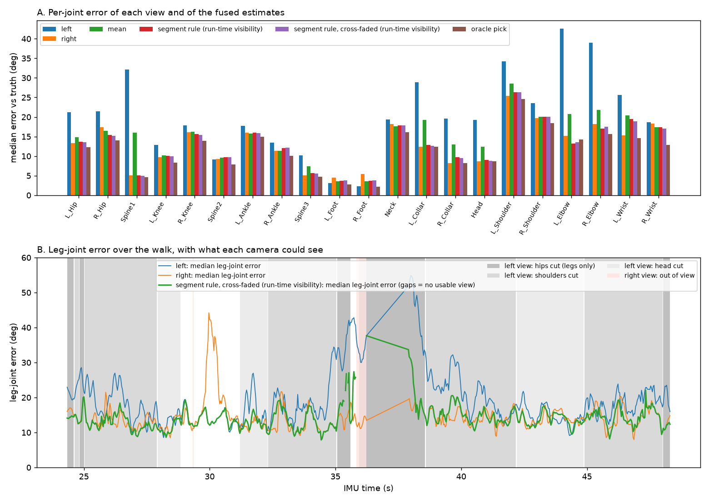
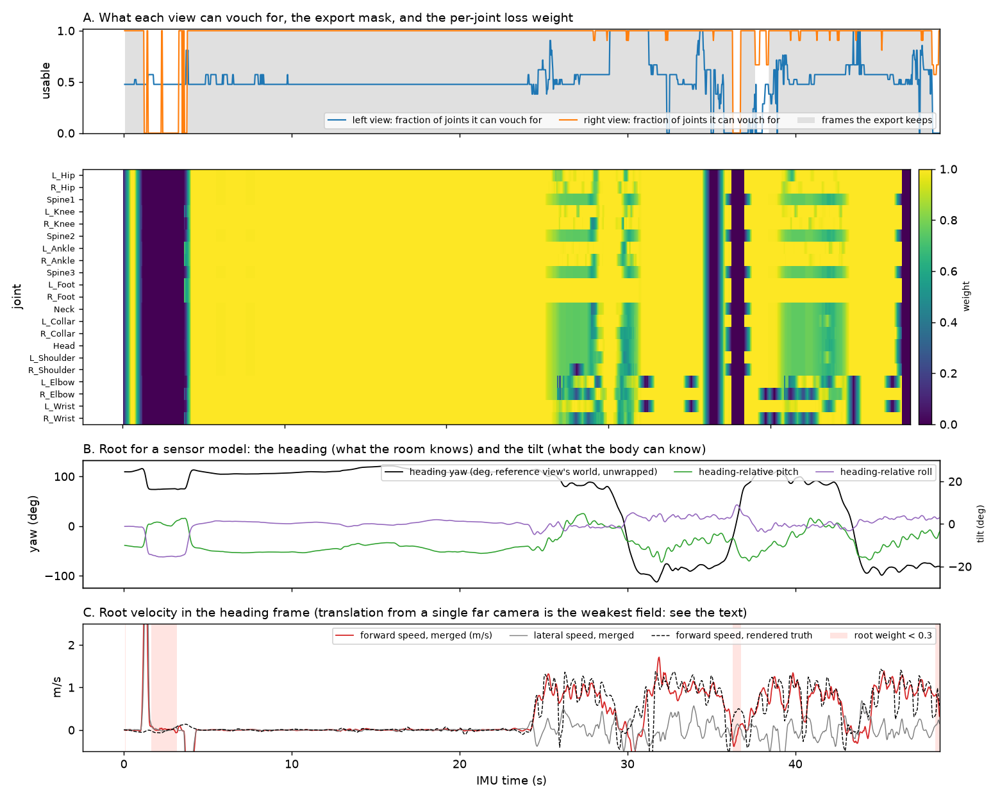
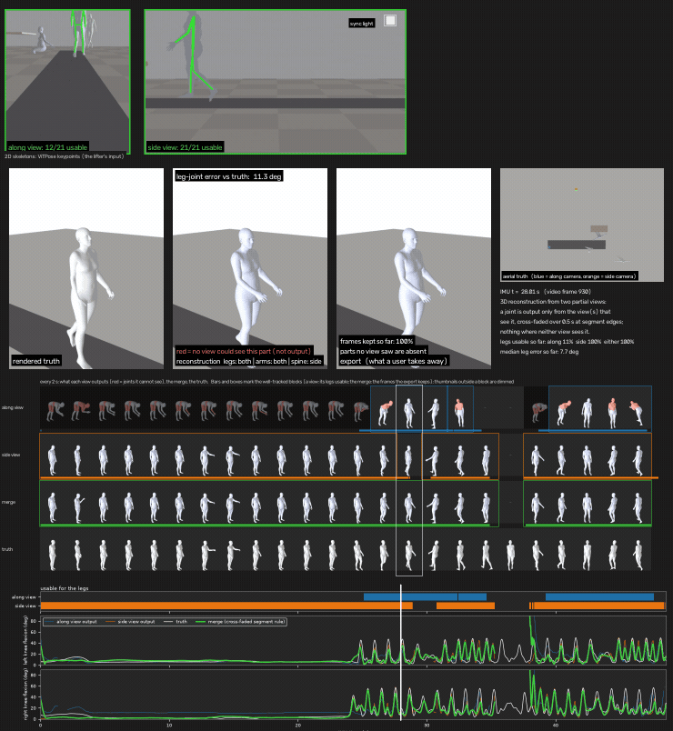
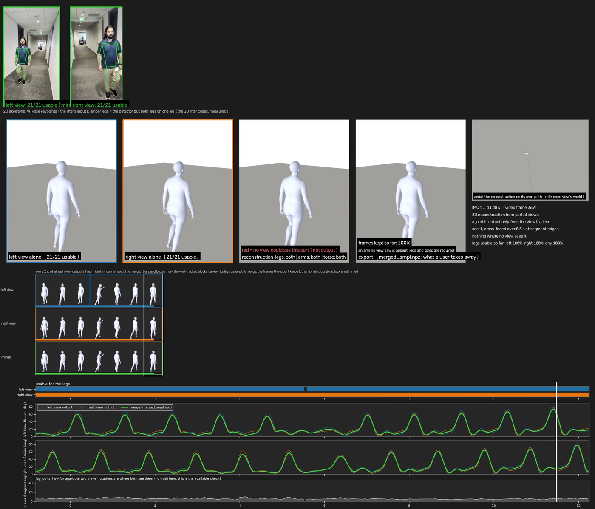

# Method and measured results

Everything here was measured against a known truth: the six rendered sessions (HC900 to HC905, rooms laid out like
the clinic's, the walker's true SMPL pose saved beside each render) and one real two-camera recording with a
measured distance (OWN03). The [README](../README.md) has the summary tables and says how to run each stage; this
document is the record behind them: what two partial views give back as one 3D pose, the rules the merge follows
and why, the sessions in a partner-style folder, the other tasks, the score table and the effects behind it, the
joint fit against the merge, and the real clip without a truth. [design.md](design.md) has the design history and
the open questions.

## Partial bodies, exits and re-entries

A gait-lab camera at the end of the walkway cuts the head off when the participant is close, and a side camera
loses the participant beyond the ends of the mat. A lifter run naively on such footage either crumples the body
or jumps to whoever else is in frame. What the pipeline does, and what the synthetic session measured on a T4
(its first render, whose narrow side camera lost the walker at both ends of the mat; the shipped render has the
room-wide side camera described further down, and its numbers are in the sections that follow):

* **Who gets lifted.** GVHMR is driven with the subject's own box track, so an exit never becomes a jump to a
  bystander; the measured per-frame joint-rotation step in the lifted output is 1-2 deg median, and the two frames
  of the side view that step more than 30 deg (one bridged, one near the end of the recording; 39 deg at most) are
  flagged as such. Body shape is constant within a chunk.
* **Exits longer than `absence_split_s` (2 s)** end the lifter chunk; a new chunk starts at the re-entry
  (`chunk_id` changes, and `transl` is only continuous within a chunk, since the world frame is re-anchored by each
  GVHMR run). Nothing is lifted in between: on the sample's side view the two exits (3.4 s and 2.1 s) become gaps
  in the output (three chunks of 885, 340 and 127 frames), and GVHMR's first second after each re-entry disagrees
  with the other view by 10.4 and 12.9 deg against 5.3 deg in steady state, a warm-up and no jump. Shorter gaps (a
  brief occlusion, a lost detection) are bridged with interpolated boxes so GVHMR keeps its temporal context, and
  those frames are flagged `visible = False`. The flag matters: bridged frames of a true exit disagree with the
  other view by 16.5 deg median (p90 38), whereas the 90 bridged frames of the along view, where the tracker merely
  lost a person who was still in frame, agree at 5.0 deg. Drop them, or weigh them by that flag.
* **Head or feet cut off** is handled by GVHMR itself: on the 777 along-view frames with the head out of frame, the
  leg joints agree with the side view at a median 4.4 deg (p90 5.7 deg), closer than on the frames where that view
  sees the whole body from far away (9.5 deg), and nothing collapses. The
  cost is a per-view body-shape bias (`betas` differ between a truncating and a non-truncating view), which is why
  shape should be taken from the view that sees the whole body. Such frames carry `edge_truncated = True`.
* **A subject at rest whom the detector loses.** A person standing small and still in a room-wide view can go
  undetected for seconds, and that view then has no box to lift from. With `params.rest_hold` (default on), inside
  the intervals the recording's events mark as standing or sitting, a frame without a detection keeps the subject's
  box: interpolated between two detections whose boxes overlap (IoU 0.8 or more), or the nearest detection's box
  before the first and after the last. Those frames are lifted with the rest, and the merge uses one only if the
  lifter's 2D keypoints, taken inside the held box, find the shoulders, hips, knees and ankles where the nearest
  detected frame has them (median confidence 0.5 or more, displaced by at most 5 % of the box height). On the six
  rendered recordings 409 held frames are accepted, 232 and 164 of them the standing starts of two side views, and
  two frames of the TUG are refused. Against the truth their legs are 11.8 deg off at the median, as good as the
  rest frames the detector did find (11.4).
* **Per-frame quality, so nobody has to infer it:** `visible`, `edge_truncated`, `rest_held`, `pose_step_deg`
  (largest joint step from the previous frame) and `chunk_id` in every SMPL NPZ; `pose_agreement_<a>_<b>.npz` beside
  `reconcile.json` with the per-joint disagreement between the two views on every IMU frame; and a QC flag when any
  frame moves a joint by more than 30 deg in one frame.

The synthetic sessions are real three-dimensional scenes, not composites: `tools/make_sample.py` places the
walker (an SMPL body driven by a public WearGait inertial fit), the co-walker, the seated operator, the desk, the
bystander, the mat, the floor tiles and the walls in one world, puts two perspective cameras where the aerial panel
of the demo draws them (their poses and intrinsics are saved in the truth file as `<view>_cam_pose` and
`<view>_intrinsics`), and renders each camera's picture with pyrender, an OpenGL rasteriser. The per-view truth
(`<view>_joints2d`, the in-frame flags) is the projection of the same joints through the same cameras, so a view's
truncation, a camera's height and tilt and the panel sizes are what the geometry gives, not what was drawn by
hand. The bodies wear flat colours, a top and trousers different for each person: a uniformly pale body standing
small and still in the side view was missed by the person detector, and a room of identical bodies does not exercise
the torso-colour descriptor. What the renders still lack is appearance (fabric, lighting, lens distortion, motion
blur), which a game engine would add and which matters for the 2D detectors rather than for the geometry; the
real-footage examples carry that test.

These numbers come from rendered bodies. GVHMR on real clothed, truncated people is on the list of things only the
first real run can show.

## 3D reconstruction from two partial views

The real session layout is harsher than the dry-run sample: the along-walkway camera sits at the end of the mat,
so the participant fills and overflows the frame when close, and the side camera's framing cuts the head. To ask
whether two such views still give back one correct 3D pose, `sample_v2/` renders the same walk from an along view
that keeps only the legs when the walker is near (hips out of frame half of the time) and saves the walker's true
SMPL pose and 3D joints beside it. The experiment below was run on its first render, whose side view was aimed at
hip height (head above the frame in 77 % of frames); the shipped `sample_v2/` has been rendered twice since, first
with the room-wide side camera of every other sample and then with the corrected walking path and the dressed
bodies of the current samples, and its current numbers are under "The merge" and "How good these
scores are". `tools/two_view_fusion.py` measures, against that truth, each view's GVHMR error per joint and by what
the camera could see, and the error of three fused estimates (plain rotation mean, ViTPose-confidence-weighted
mean, and an oracle per-joint pick as the upper bound). The rotations GVHMR returns are camera-independent apart
from a constant heading offset between the two cameras' world frames, which the script fits and removes.

Two things this sample taught before any GPU was involved. First, with the camera 0.5 m from the end of the mat,
the automatic pelvis match cannot confirm the along view: close to the camera, the walker's forward-speed
oscillation moves the hip row more than the vertical bob does, a step-periodic signal with the wrong phase. The
side view confirms and synchronises the recording on its own (offset 2.995 s versus 3.000 planted, 100 % of
frames on the true hips), and the along view is taken from an operator pick, which is why picks can now be
given as a frame and a point and shipped with a data set (HC901 carries one). Second, the pose signal survives a
cut head: a truncated box's height follows the frame edge, but the gait-band content of the pelvis signal does not
depend on it.

Lifted on the T4 (CPU stages locally in the pinned environment, `wgvp gvhmr` alone on the box; 1395 frames with
the truth and both views lifted), the answer is measured rather than argued
([two_view_fusion/two_view_fusion.md](two_view_fusion/two_view_fusion.md)):

| estimate against the rendered truth | leg joints, median | legs > 20 deg | all 21 joints | knee-flexion RMSE |
|---|---|---|---|---|
| along view alone (hips out of frame 60 % of the time) | 14.9 deg | 34 % | 21.7 deg | 14.8 deg |
| side view alone (head cut 77 % of the time) | 10.3 deg | 11 % | 11.5 deg | 8.2 deg |
| fused, plain rotation mean | 12.7 deg | 27 % | 16.2 deg | 8.6 deg |
| fused, weighted by per-joint visibility | 9.6 deg | 9 % | 11.9 deg | 10.3 deg |
| **segment rule**: a joint only from the view(s) whose keypoints for it are in frame, averaged when both, nothing when neither (98 % of cells emitted) | 10.1 deg | 9 % | 13.1 deg | 8.6 deg |
| **segment rule, cross-faded** over the first and last 0.5 s of each usable segment | 10.1 deg | 9 % | 12.7 deg | 9.9 deg |
| **segment rule, cross-faded and smoothed** (5-frame rotation average within emitted segments) | 10.1 deg | 9 % | 12.7 deg | 9.9 deg |
| **segment rule, cross-faded, each view weighted by its share of the fused root, smoothed** (the demo's output) | 10.0 deg | 8 % | 11.4 deg | 7.4 deg |
| fused, oracle per-joint pick (needs the truth) | 9.4 deg | 5 % | 10.7 deg | 5.1 deg |

What this says. A cut head costs nothing: the side view's head-cut frames are at least as accurate as its
whole-body frames (8.5 versus 14.3 deg on the legs). The along view's leg joints hold at 14-17 deg whatever is cut,
down to the frames where only the legs remain (14.4 deg), but on those frames everything above the hips is
invented (34 deg over all joints) and, as the next paragraph shows, the root pitches forward by 50 deg. Two partial
views do give one 3D pose, and the rule that works is the plain one: cut each view into the segments where it can
actually see a joint, combine on the shared timeline, and output nothing where neither view saw it. Implemented
with a run-time test only (the ViTPose keypoints a joint moves must be confident and inside the panel), that rule
emits 98 % of joint-frames with the leg error and leg outliers slightly below the better view's (10.1 deg and 9 %
against 10.3 and 11 %). Hand-overs between views are where discontinuities would come from, since the two views
disagree by about 10 deg where both see a joint: cross-fading the weights over the first and last half-second of
each usable segment brings the merge's frame-to-frame steps down from a 99th percentile of 16.8 deg (0.79 % of
steps over 20 deg) to 5.5 deg (0.03 %), fewer than either view alone, at the same error. What remains is the
lifter's own frame-to-frame jitter inside a segment; a 5-frame moving average in rotation space, computed within
runs of emitted frames so that gaps stay gaps, takes the merge to 4.1 deg (no step over 20 deg) without changing
the error. Soft weighting by ViTPose confidence does none of this (it never drops a view). But note the
knee-flexion column: up to this point the merge is no better than the side view alone (9.9 against 8.2 deg),
because wherever both views qualify for a leg joint the along view's poorer estimate is averaged in at equal
weight. The missing piece is a per-view reliability signal, and the root turned out to provide one. The oracle
per-joint pick shows what is still left on the table after that (leg outliers 8 % to 5 %, knee-flexion RMSE 7.4
to 5.1 deg) for a selector that knows more than visibility.

The root orientation needs its own rule, and it turned out to carry the reliability signal. GVHMR's root for
the along view pitches forward once the body is cut: +17 deg (signed median) with the shoulders out of its frame
and +50 deg with the hips out, against -5 and -3 deg for the side view, and its hip joints absorb the difference
(22 against 15 deg of hip error on the shoulders-cut frames, 56 against 8 on the hips-cut frames): the body looks
right in that camera and wrong in the world. A root mean weighted by usable-joint counts let that pitch in and out
of the reconstruction whenever the along view's count changed, a visible rocking of the whole body. The merge's
root is now the quaternion mean of the views' roots, each weighted by its presence (ramped over 0.5 s at the edges
of its lifted runs) times the square of the fraction of joints it finds usable (averaged over the same 0.5 s),
sharpened towards the heavier view when the two roots disagree by more than 30 deg: two good lifts of one walker
agree to about 10 deg, so a larger gap means one of them is wrong. When they disagree and weigh the same, two
continuity terms decide first: a view whose root turned faster than a person can (over 150 deg/s) since its
previous frame is discounted, and so is a view far from the previous fused root. That is the case of a 180-degree
turn that one view's lift takes the wrong way round, snapping through the front/back ambiguity: on the TUG sample
the side view's heading jumped 120 deg in a quarter of a second while the chair-facing view turned with the truth,
and the plain mean of two opposite headings had snapped the reconstruction instead of turning it; with the
continuity terms the merged heading stays within 5 deg of the truth through the turn (2.5 deg median over the
recording, no step over 90 deg; `merge.json` counts such steps). Those two terms are causal and cannot settle the
other form of the same failure: a view that turns the wrong way round at a human rate, indistinguishable from the
right one while both turn, and gives itself away only by snapping onto the true heading once the turn is over
(Sub 003's self-paced walk did this at both of its turns, 170-deg snaps in the side view, and the merge, which had
locked onto that heavier view, snapped with it). The merge runs offline, so a third rule reads the whole recording
first: within every episode of disagreement, a view whose own root turns more than 90 deg within a quarter of a
second, during the episode or just after it, is the one that took the turn the wrong way (a person cannot; the
snap is the lift's own correction), and it carries no weight over that episode, up to 4 s either side of its
snap. The same episode can also end without a snap when the wrong view's coverage simply runs out (the walker
turns out of its frame at the end of the mat, as the hurried walker did in the side view): nothing resolves the
disagreement, and at the hand-off the merged root would jump by the whole gap onto the surviving view, so a view
whose coverage ends, or begins, inside an episode while another view continues through it is treated like a
snapping one and carries nothing over that episode. When no view snaps or departs, or more than one does, the rule
is silent and the causal terms decide. That removed every flip of the rendered set. Every term is continuous in
its inputs, so nothing in the rule can step the root (`wgvp.fusion.fuse_root`).

Two more things had to change before the turns themselves read right. A view's lift can flip its root for a frame
or two and come straight back (16 frames of HC901's along view and 2 in each view of HC902 on the earlier
renders; 2 frames of an along view in two of the shipped recordings). Read as a snap, that
glitch made the offline rule set aside the view that was right, and the merged turn then completed in 0.6 s where
the walker took 1.6. Such an excursion, a step of more than 60 deg that is back where it was within 0.2 s, is now
interpolated across in each view before anything else reads that view's root (`repair_root_glitches`; counted per
view in `merge.json`). And the arbitration between the views is averaged over the cross-fade time, with the fused
root smoothed over 5 frames after it, so a hand-over inside a turn no longer shows as jitter. Over the 24 turns of
the six shipped recordings, lifted with each camera's field of view (below), the merged turn takes within 0.12 s of
the truth's time on average (10-90 % of the heading change; 0.27 s at worst) and peaks at 1.08 times the truth's
rate (1.29 at worst; before these changes, on the earlier renders, 2.9 on average and 29 at worst). Its heading is
3.8 deg from the truth at the median of a turn, 10.5 deg at the worst moment of an average turn, and 18 deg at the
worst of all (HC901). Under the lifter's default camera the same three numbers are 8.6, 18.0 and 41 deg, and one
turn of HC902 that takes 1.37 s in the truth lasts 2.03 s in the merge; with the field of view it lasts 1.40 s.
`merge.json` also counts the turns no person makes (`root_turns_over_90deg_in_quarter_s`): none on the six.

The same share then scales that view's weight for all
of its body joints, since a lifter that got the gravity frame wrong solved the whole body in it. On the
experiment's render this took the fused root to 6.6 deg (the views: 49.6 and 7.3) with a frame step at the 99th
percentile of 5.4 deg (the side view alone 7.3), and the merge below the better view in every column: legs 10.0
deg, outliers 8 %, all 21 joints 11.4 deg, knee-flexion RMSE 7.4 against the side view's 8.2 (last segment-rule
row of the table), at 98 % coverage and steps of 4.8 deg at the 99th percentile.

On the second render of HC901, with the room-wide side camera, the along view is the same stress case (its track
holds the walker for 99 % of the span, the standing phase attached by continuity, but its legs are usable on 35 %
of the span, its hips on 35 % of its own frames and the shoulders on 9 %; knee-flexion RMSE 46 deg over all of its
frames and 11 where its legs are in frame) and the side view now sees the whole walker but for the top of the head
(legs usable 95 %): alone it is at 11.4 deg on the legs (7 % of its leg-joint errors over 20 deg), 11.6 over all 21
joints, knee-flexion RMSE 5.9. The merge matches it on the legs (11.3 deg, 7 %, 11.6 over all joints) at 91 %
export, and on the 511 frames where both views have the legs it is below either view (13.0 deg against 13.6 and
15.5; knee-flexion RMSE 7.4 against 7.6 and 11.3), the along view's share of the root being 12 %. Over the export
its knee-flexion RMSE is 6.6 against the side view's 5.9, and the difference is seven frames (without them the
merge is at 5.9): the side view returns from its gap at 3.8 s while the walker stands, the cross-fade at the edge
of its run hands the along view the weight for a fifth of a second, and the along view's knees on a legs-only crop
of a standing walker are 20-75 deg wrong; those seven frames carry a knee weight of 0.1-0.7. Elsewhere in the
standing phase the merged knee is the side view's, 3 deg off, and it keeps its weight: the per-joint loss weight
reads a view's dissent by its share of the root (read in full, the along view's dissent would have put those knees
at 0.2). Its root error, 14.8 deg, is not the along view's pitch this time but the side view's: lifted from a
camera 2.3 m up looking down at the mat, GVHMR's gravity frame holds the pelvis pitched 6-15 deg from the truth on
every rendered session (the along views: 3-9 deg), the views are aligned by a yaw and an offset only, and the
merged root carries the views' tilts in proportion to their shares of it: on that round's renders, 14.8 and 15.4
deg here and in the TUG, where the side view held most of the root, and 6.4-9.1 on the other walks, where it held a
fifth to a half. A full-rotation alignment of the views onto the more upright one is the open item for that.

The side view's heading carried a second error, with a known cause and now a remedy. Left to itself, GVHMR
assumes a camera whose focal length equals the image diagonal, which for these panels is 1.5 times the along
camera's real focal length and 2.1 times the side camera's. A lifter that takes the lens for longer than it is reads
a walker off the optical axis as turned: on the six shipped recordings lifted that way, the side view's heading
error follows the walker's bearing from the axis at 0.86 deg per degree (r = 0.86). Taking that term out inside the
merge did not carry through to the body, which the lifter solved under the same wrong camera. The place for it is
the lift. With `gvhmr.focal_35mm` GVHMR is given each camera's real field of view, and the slope falls to 0.11 deg
per degree (r = 0.44), the side view's median heading error from 5.3-14.3 deg to 3.2-7.5 over the six recordings,
and the merged root's error from 13.3 to 10.3 deg. The bundled samples are lifted that way, and the two lifts are
compared under "How good these scores are". The tilt remains: the merged root is still 7-15 deg off, more than the
heading's 2-4 deg accounts for, and a full-rotation alignment of the views stays open.

What an export keeps is stricter than what the reconstruction shows. The red parts are filled only so the mesh can
be drawn; the export (`export_mask`) keeps a frame only when every leg joint and every torso joint (spine, neck and
head) is output, in runs of at least 0.5 s, and on those frames contains only the joints some view saw. An arm no
view saw is absent from an exported frame (NaN, weight 0); a frame without the whole legs or the whole torso is not
exported at all. On HC901 that is all of the IMU span (the along view alone has the legs for 41 % of it, the side
view for all of it). The torso is what the rule costs where one camera stands close: a view that shows the walker
from the chest down cannot vouch for the upper spine, and when the other view has no subject on those frames they
are dropped (`merge.json` gives the share as an `info:` flag, which does not change the status). On the earlier
renders that took 7 % of HC900's frames, 9 % of HC902's and 37 % of the hurried walk's. Two changes brought the
shipped six to 99.8-100 %. The shoulders now count down to 4 px from the top edge of the picture (8 px for every
other keypoint), and down to 2 px on a frame joined to a run that passes at 4: the spine's error does not rise
before that (8.3 deg at the median with the rule, 9.0 at 8 px), and of 15,855 view frames the trunk passes on 14,344
where it passed on 10,875. And the rest hold (above) gives the side view the standing walker the detector had
lost.

## The merge: `merged_smpl.npz`

`merge.json` beside it holds the numbers: export fraction, continuity, the alignment residuals, the views' body
shapes and their difference, flags. On two of the synthetic sessions, against the rendered truth: HC901 (the
compromised views) exports all of the lifted frames with legs at 10.7 deg median, knee-flexion RMSE 5.3 deg, root
12.5 deg. HC900 (the dry-run session) exports all of them at 9.5 deg legs, 5.0 deg knee RMSE, 8.1 deg root, with
the views' roots within 10 deg of each other after alignment. The weight separates good cells from bad ones on the
five walks (median leg error 10.6 deg where weight > 0.5 and 13.4 below on HC901; 9.4 and 12.6 on HC900) and not on
the TUG (16.8 and 12.9): in the chair the two views mostly agree with each other (weight 0.77 at the median) on legs
that are 26.5 deg from the truth, and agreement between the views is all the weight reads. The weakest field is the
translation. A view's position is a monocular depth estimate, and after alignment the two
views' pelvis positions stand 0.35 to 1.7 m apart at the median on the six recordings. The merged path does not
average those positions. It sums the views' per-frame steps, each counted in full across its camera's line of sight
and at 0.05 along it, and lies 0.16-0.34 m from the truth at the median after one rigid fit. The distance between
the views is recorded as `transl_disagree_m` and not weighted (see the table). When the recording
CSV carries the pressure walkway, the merge uses it two ways. The WearGait export carries the walkway in 1,574 of
its 1,577 files, whatever the task (the mat records all through a session): at every 10-ms sample the lists of
loaded cells, `Walkway_X` / `Walkway_Y` as `'x1|x2|...'` cell indices on the GAITRite's 384 x 48 grid of half-inch
cells (4.88 x 0.61 m; `params.walkway_cell_cm`, 1.27), with each cell's footprint label in `WalkwayFoot` (`L`, `R`,
or `Other 1` for what the software did not assign) and its pressure level. The reader (`wgvp/imu_ref.py`) turns
them into the pressure-weighted centre of each labelled footprint per sample and groups those into stances (first
and last sample, median centre; 0.6 s each in a self-paced walk); unlabelled cells are counted and ignored. From
the stances the merge (a) fits per view one depth-scale factor of its path about the path's own centre, the mat's
yaw and offset in that view's world, against the landing foot's position (a model-free forward kinematics of the
mean body gives the feet), accepted only when its residual stays under 0.5 m, writing `transl_scaled` and
`walkway_scale`; and (b) builds the pelvis path **on the mat**, `transl_mat`: during each stance the walkway knows
where that foot is and the video pose knows where the pelvis is relative to it, both feet count during double
support, each stance's say ramps in and out over 0.12 s, gaps under 0.5 s are bridged. On the rendered mat
session (`sample_v6`, whose CSV carries cells fabricated from the rendered truth in the export's own form) the
video's path is 0.21 m from the truth at the median and 0.28 m at the 90th percentile, the scale-calibrated one
0.18 / 0.28 m, and the path from the walkway 0.03 / 0.11 m over the 91 % of frames it covers; in the mat frame,
with no fitting at all, its bias is 0.3 cm along the mat and 2.8 cm across. That measures the mechanism, not the
mat: the fabricated footprints come from the same truth as the video. The scale fit, by contrast, does not help
much (it fixes the path's length, not the per-frame error), because GVHMR's world path is integrated by its
network, not projected from the camera, so a scale applied afterwards has little to correct. What did move the
path is the camera given at the lift: with each camera's field of view the views' own paths are 0.19-0.50 m from
the truth at the median, where under the default camera they were 0.31-0.77. One caution for anyone testing
this on the rendered samples with the public recordings' own walkway rows: the render walks the neutral SMPL body
along a stance-pinned path that is 22 % shorter than the real walk the mat recorded (hc105: 3.4 m of footfalls
against 4.5 m), so the real footprints do not describe the rendered video; the samples' CSVs carry empty walkway
columns except the mat session's fabricated ones. The heading-frame velocity is the fused video path's
everywhere. On the mat its mean over 1.5 s is set to the mat path's, which keeps the video's detail within a stride
and takes the mat's measured progress: on the mat session the exported forward speed is 0.185 m/s RMS from the
truth, against 0.196 from the video alone and 0.348 when the velocity was the mat path's own derivative.

*The merge of HC901 (`tools/make_target_figure.py`). A: what each view can vouch for, the export mask and the
per-joint weight; the along view (blue) vouches for a third to two thirds of the joints while the walker stands at
its feet (to 24 s) and for all of them only in parts of the walks, the side view (orange) for nearly all of them
throughout, and the export keeps the whole span. The weight dips in the first two seconds and during the walks,
where both views vouch for a joint and disagree. B: the heading, with the turns near 30, 37 and 43 s, and the
heading-relative tilt (the pitch sits 10 deg below zero while the walker stands: the side view's gravity frame, see
the text). C: the root's forward speed in the heading frame against the rendered truth: zero to 24 s, then four
bouts at about 1.2 m/s.*

*Fourteen seconds of HC901's walk, IMU 26-40 s (`python -m wgvp demo`, full video in the results of the run). Top: the two views with
ViTPose's keypoints for the chosen subject (the lifter's input; the left/right labels of the arms and legs are
kept consistent from frame to frame for the drawing, because 2D estimators flip sides on a side-on walker, and
the 3D stage does not use them) and what each view can use; the bright square in the side view is the sample's
sync light, lit while the IMU records, which the flash cross-check reads. Middle, left to right, three close-ups
that stand in the truth's room (its position, its floor and its mat; the reconstruction and the export are turned
into the room by one yaw fitted over the whole recording, so a walker facing another way than the truth is a
heading error, and the leg and root-orientation errors of the frame are printed): the rendered
truth on the mat; the reconstruction (red = a part no view could see, filled only so the mesh can be drawn; the along view
holds only the legs when the walker is near, and the upper body GVHMR invents from them is exactly what gets
excluded; near 38 s, the walker at its feet, it vouches for 8 of the 21 joints); the export, in which such parts are absent and a dropped frame shows the empty mat; and the whole room
from above: mat, walker, the operator at the desk, the bystander, the along camera (blue) and the side camera
(orange). Without a ground truth (a partner's recording) the truth panel and row are absent and the aerial view
shows the reconstruction on its own path. Bottom, the readout in two forms (`--readout strips|charts|both`): a filmstrip with a small render
every 2 s of what each view outputs (joints it cannot see in red), the merge and the truth, with the well-tracked
blocks marked at frame resolution by a bar under each row and a box around the consecutive thumbnails inside one
block (a view: its legs usable; the merge: the frames the export keeps; thumbnails outside a block are dimmed);
then the same as timelines on the shared IMU axis: each view's knee-flexion output (blue, orange), the merge
(green, with gaps where no view saw the joint) and the truth (white). The side view has the walker throughout;
the merge follows whichever view can see and hands over without a step.*

## Three subjects in a partner-style folder

To check that the package runs off a study folder rather than off its own samples, three synthetic sessions
were laid out as `Sub 001/Video/SP_combo.mp4` with the recording export under `Sub 001/IMU/` (the layout shown in the
README under "Expected input"; `tools/make_partner_layout.py` builds it), scanned with the default rules, run on the CPU,
lifted on a T4, merged, and rendered with `wgvp demo`. Every sample's room follows the real session's, measured
on a Video Labeler frame: the side camera elevated, about 4 m from the mat with the operators' desk in the
foreground, so that the 16 x 2 ft mat spans some 60 % of its panel and a walker on it has the top of the head at
the top edge; the along camera at one end of the mat about 1 m high, so that a walker 2-3 m away shows from the
chest down (`sample_v2` keeps its lower, closer along camera as the truncation stress test). The self-paced and
hurried walks step off the mat's ends to turn, as in the clinic, and the side view keeps the walker through the turns
and, with the rest hold, through the standing start at the near end of the mat, where the detector loses a walker
who stands half out of the panel's edge. The third session is a new room
(`sample_v3/`, HC902): another walker (hc105), a co-walker on the far side of the mat, the along camera at the
other end of the mat and the side camera on the other side of the room.

The scan paired every video with its recording without a config edit. Against each session's rendered truth, on
the exported frames:

| session | export | legs (median) | knee-flexion RMSE | root | views turned onto each other to |
|---|---|---|---|---|---|
| Sub 001 (HC900) | 100 % | 9.5 deg | 5.0 deg | 8.1 deg | 10 deg, 1.70 m |
| Sub 002 (HC901) | 100 % | 10.7 deg | 5.3 deg | 12.5 deg | 9 deg, 0.76 m |
| Sub 003 (HC902) | 100 % | 11.1 deg | 6.9 deg | 7.4 deg | 11 deg, 0.57 m |

All three export the whole of the lifted span. In the earlier renders the legs-and-torso rule left out 9-10 % of
each: the frames in which the walker stood or turned close to the along camera, in its picture from the chest down,
while the side view had no subject. The shoulder rule and the rest hold (above) closed that.

The position figures in the last column are informational. After the alignment the two views put the pelvis 0.6-1.7
m apart on the frames both see, each a monocular depth, and the merge records that as an `info:` flag and discounts
nothing for it: the merged path is summed from each view's steps and not averaged from its positions (see "The
merge"), and `transl_weight` is 0.99-1.00 on all three, against 0.85-0.92 for the pose weights. The roots
turn onto each other to 9-11 deg. Every view found its subject from the accelerometer (r = 0.74-0.79 in the along
views, 0.48-0.63 in the side views), and the sync landed within 13 ms of the truth, confirmed by the light. Sub 003
finishes at PASS, Sub 001 and Sub 002 at WARN: Sub 001's side view has two frames with a joint-rotation jump over
30 deg per frame, and Sub 002's along view has three, together with a tracker fragment cut at an identity switch
(its track is four fragments, two accepted on their own timing and two attached by continuity). The CPU stages took
50-70 s per recording on a laptop, and the lift about 10 minutes per recording on a T4.

The first version of the third session used a walker whose sensor-derived path covered a single metre with a 5-mm
pelvis bob, and it produced the one confidently wrong result of these runs: the side view fragmented, the fragments'
own lags disagreed, and the joint lag landed 30 s off with a "high" confidence while the sync light sat uncompared
3 s into the video. That is where the two sanity rules of the README's "How the subject is found and synced" come from; both fire on
the case. The walker was
replaced for the shipped sample, and the episode is written up in the design notes (section 2.8).

## Other tasks, and a mat walk with the walkway

Three more recordings were rendered and run through the same folder: a **Timed Up and Go** (`sample_v4`, HC903,
Sub 001's second recording: hc142's three repetitions of sit, stand, walk 3 m, turn, walk back and sit, with a
chair; the along camera faces the chair from beyond the turn), a **hurried-pace walk** (`sample_v5`, HC904, Sub
003's second recording: hc105 at speed with a co-walker, overshooting the mat at both ends) and a **self-paced walk
on the instrumented mat** (`sample_v6`, HC905, as Sub 004: hc105 in HC902's room, with the recording's walkway
columns fabricated from the truth in the export's own form, see above). Tandem gait has no public IK sequence to
render from. All three paired, synced and selected without a config edit (sync within 16 ms of the truth; every view
found its subject from the accelerometer, at r = 0.78 and 0.63 on the TUG, 0.85 and 0.65 on the hurried walk and
0.67 and 0.51 on the mat walk), and lifted and merged like the others:

| session | export | legs (median) | knee-flexion RMSE | root | two views' leg disagreement |
|---|---|---|---|---|---|
| TUG (HC903, hc142) | 99.9 % | 16.4 deg | 11.9 deg | 15.1 deg | 10.8 deg |
| hurried pace (HC904) | 99.8 % | 12.0 deg | 7.0 deg | 10.5 deg | 8.9 deg |
| mat walk (HC905) | 99.8 % | 9.2 deg | 5.7 deg | 8.4 deg | 9.2 deg |

The TUG walker is hc142: the first render used hc100's TUG, whose inertial fit carries its left ankle 163 deg off
(a visibly wrong foot in the rendered truth, and 26 deg of "error" that belonged to the truth), while hc142's fit
passes the ankle check (median ankle angles 10 deg, knees to 85 deg when seated). The TUG's errors are the largest
of the set and they sit in the chair. By phase, its legs are 12.9 deg off at the median while walking, 13.9 in the
turn and 15.1 turning to sit, like the walks, and 22.5 rising and 26.5 seated; its root is 9.7 deg off walking, 14.2
turning and 21.5 seated. The merge reads the seated knee 14 deg short of the truth. Both views have the seated legs
in frame and they mostly agree there (the weight on the seated legs is 0.77 at the median), so the weight does not
mark these frames, and the seated posture is the largest error left in the set.

The hurried walk was the hard case of the earlier renders. For its first 11 s the walker waits at the near end of
the mat, in the along camera's picture from the chest down, and the side view's detector loses them for about half
of that time. No view then has the torso, and the rule drops those frames: the export was 62 % on the earlier
render, and 81 % on this one before the rest hold. With the hold the side view keeps its box through the standing
start (164 frames, accepted by the keypoint check), the export is 99.8 % and the merge has the legs on every frame. On an earlier render the side view's lift
turned the wrong way at the final turn and ran out of frame mid-turn, the case that gave the root rule its departure
clause.

## How good these scores are, and what would improve them

Against the rendered truth, on the frames each recording exports. The six columns are the shipped samples, lifted
with each camera's field of view; the last column is the mean of the same six lifted with GVHMR's default focal
length.

| | HC900 | HC903 (TUG) | HC901 | HC902 | HC904 | HC905 | mean | mean, default camera |
|---|---|---|---|---|---|---|---|---|
| export (% of lifted frames) | 100 | 99.9 | 100 | 100 | 99.8 | 99.8 | 99.9 | 99.9 |
| legs, median (deg) | 9.5 | 16.4 | 10.7 | 11.1 | 12.0 | 9.2 | 11.5 | 11.8 |
| knee-flexion RMSE (deg) | 5.0 | 11.9 | 5.3 | 6.9 | 7.0 | 5.7 | 7.0 | 7.0 |
| root, median (deg) | 8.1 | 15.1 | 12.5 | 7.4 | 10.5 | 8.4 | 10.3 | 13.3 |
| heading, median (deg) | 1.7 | 3.9 | 4.1 | 2.7 | 2.7 | 3.3 | 3.1 | 5.9 |
| spine, median (deg) | 9.7 | 10.4 | 9.1 | 8.4 | 9.2 | 10.2 | 9.5 | 9.1 |
| arms, median (deg) | 15.6 | 16.8 | 17.0 | 15.0 | 15.8 | 16.3 | 16.1 | 16.5 |
| path after one rigid fit, median (m) | 0.16 | 0.19 | 0.33 | 0.18 | 0.34 | 0.21 | 0.24 | 0.38 |
| speed RMSE while moving (m/s) | 0.134 | 0.153 | 0.148 | 0.216 | 0.221 | 0.185 | 0.176 | 0.193 |

The leg, root, spine and arm figures are three-axis rotation errors per joint, a stricter measure than a flexion
angle. They are the lifter's numbers more than the merge's, and the merge adds a little to them: over each view's
own frames the merged legs are below both views on five recordings of the six (on the hurried walk they are 0.9 deg
above the along view's), and the merged knee RMSE is below both views on five (on HC902 it is 0.1 deg above the
side view's). The walks' legs and headings are the strong part. The seated phase of the TUG and the arms are the
weak part, and four measurements say where the rest sits.

**Field of view.** Giving the lifter each camera's real field of view (`gvhmr.focal_35mm`) in place of its default
focal length, which is 1.5 and 2.1 times too long for these two cameras, moves the root from 13.3 to 10.3 deg and
the heading from 5.9 to 3.1 at the mean, the path from 0.38 to 0.24 m, and the worst heading error inside a turn
from 18.0 to 10.5 deg (mean over the 24 turns). The legs and the knee do not move, and the spine is 0.4 deg worse.
A second pair of lifts, without the rest hold, gave the same step (root 12.8 to 10.2 deg, heading 5.6 to 3.0). The
samples' config carries the two focal lengths. A real camera's has to be read from its lens or from the picture
(`tools/estimate_focal.py`, in the README under "Expected input"), and no clinic recording has had either yet.
The bundled phone clip has: see "When there is no truth" below.

**Amplitude.** The lifter draws every stride toward an average one. In a share-weighted mean of the two views the
knee's flexion has 0.71 of its true range and the hip's 0.62 (the slope of the estimate on the truth, outside the
rest intervals). The views do not read it alike: the side view, which sees flexion in its image plane, has slopes of
0.77-0.90 for the knee and 0.80-0.91 for the hip; the along view, which sees it as depth, 0.38-0.83 and 0.16-0.48.
Weighting whole leg joints toward the side view was tried and raises the three-axis leg error, since the along view
is the better one about the hips' other two axes. So the merge splits the flexion of hips and knees in two bands:
the slow part, the posture, stays the weighted mean, and the stride's swing comes from a second mean weighted by how
side-on each view sees the walker (`side_on` in the NPZ). That raises the slopes to 0.82 and 0.76 and lowers the
mean knee RMSE from 7.65 to 7.01 deg with the three-axis leg error unchanged; the hurried walk's knee RMSE is 0.3
deg worse and the TUG's does not move. What remains of the amplitude is the side view's own under-read.

**Timing.** Each view's flexion fits the truth best a quarter to half a frame ahead of it (8-17 ms), in every
recording. The 2D keypoints show no lead, so it arises inside the lifter. It is worth 0.3-0.9 deg of knee error and
is not corrected: a constant fitted to six rendered recordings is a property of one lifter's weights, and shifting
the export against the sensor timeline is the kind of error the pipeline exists to prevent.

**Path and speed.** The merged pelvis path is summed from the views' steps and not averaged from their positions,
which disagree by 0.35-1.7 m after alignment. Under the averaging rule the merged pelvis slid over the floor
whenever the views' shares changed, with the feet planted: the root's horizontal speed had an RMSE of 0.323 m/s
while the walker moved and 0.152 while they stood. It is 0.176 and 0.056 now, and the slope of estimated on true
speed is 0.88 instead of 0.70. The price is 0.05 m at the median of the path error (0.19 to 0.24 m), with the 90th
percentile better (0.55 to 0.44 m).

What would move the scores, largest first: (1) one body fitted to both views' keypoints at once, in place of the
mean of two single-view lifts. It is built, in the next section, and is the training target where its checks pass: it
supplies the depth each
view lacks (path 0.20 to 0.05 m, thigh direction 6.0 to 3.8 deg) and does not correct the tilted root, which was
expected of it; its own next step is a known camera pose; (2) the seated posture, where the root is 21.5 deg off,
the legs 26.5 and the knee 14 deg short while the two views agree; (3) the arms, at 16 deg the least accurate part
of the export and outside the export rule by design; (4) for real cameras, a measured field of view, worth 3 deg of
root and close to half of the heading error on these renders (`tools/estimate_focal.py` reads it from the room where
the camera sees the room's edges at a slant).

## One body fitted to both views: `jointfit_smpl.npz`

The joint fit (how to run it, and what its file carries: the README, "What to train on") fits one SMPL-X body per
frame to both views' 2D keypoints at once and writes `jointfit_smpl.npz` beside `merged_smpl.npz`, on the same
frames and the same joints. No calibration comes with the videos, so the fit finds the pose of one camera against the other from the walker,
starting from the two lifts. The body starts at the merge's pose and the root is held close to the merge's: twelve
keypoints say where the pelvis is and little about how it is turned. The up direction is the cross product of the
two cameras' level directions, which each lift knows from its camera's roll. Joints and frames the merge does not
export are not exported here either. The output is a 3-frame moving average (the merge uses 5).

Scored against the rendered truth on the merge's exported frames (`tools/compare_jointfit.py`; every number is in
`docs/jointfit.json`). Each cell is merge / joint fit. All rows but the last two come from joint positions: the truth
is an SMPL body and both estimates are SMPL-X, and the two models' rotations for one posture differ by 3-19 deg
depending on the joint, a floor under the three-axis errors of the table above. The knee row is therefore the angle
between thigh and shank and not the flexion component of that table.

| | HC900 | HC903 (TUG) | HC901 | HC902 | HC904 | HC905 | median |
|---|---|---|---|---|---|---|---|
| thigh direction (deg) | 4.2 / 3.7 | 9.6 / 6.5 | 4.4 / 3.2 | 6.6 / 3.9 | 6.8 / 5.2 | 5.5 / 3.4 | 6.0 / 3.8 |
| shank direction (deg) | 5.0 / 3.8 | 5.8 / 4.6 | 6.3 / 4.9 | 5.2 / 5.0 | 7.4 / 4.8 | 4.0 / 2.6 | 5.5 / 4.7 |
| upper arm direction (deg) | 9.1 / 6.2 | 9.5 / 6.5 | 9.5 / 9.3 | 8.8 / 5.8 | 7.8 / 5.6 | 8.5 / 4.8 | 9.0 / 6.0 |
| knee angle RMSE (deg) | 6.0 / 4.8 | 10.0 / 7.8 | 5.6 / 4.7 | 5.9 / 5.5 | 6.5 / 5.8 | 6.7 / 5.8 | 6.2 / 5.6 |
| ankle position about the pelvis (cm) | 11.0 / 7.8 | 11.3 / 9.9 | 8.1 / 6.6 | 8.7 / 6.9 | 8.4 / 6.7 | 6.4 / 5.7 | 8.6 / 6.8 |
| path after one rigid fit, median (m) | 0.16 / 0.05 | 0.19 / 0.10 | 0.33 / 0.04 | 0.18 / 0.04 | 0.34 / 0.06 | 0.21 / 0.02 | 0.20 / 0.05 |
| speed RMSE while moving (m/s) | 0.134 / 0.072 | 0.153 / 0.070 | 0.148 / 0.082 | 0.216 / 0.049 | 0.221 / 0.063 | 0.185 / 0.050 | 0.169 / 0.067 |
| pelvis frame (deg) | 3.6 / 3.2 | 8.4 / 8.5 | 6.3 / 6.1 | 4.7 / 4.4 | 5.1 / 4.6 | 5.0 / 5.0 | 5.1 / 4.8 |
| root, three-axis (deg) | 8.1 / 8.1 | 15.1 / 15.1 | 12.5 / 12.5 | 7.4 / 7.7 | 10.5 / 10.6 | 8.4 / 9.0 | 9.4 / 9.8 |
| heading (deg) | 1.7 / 1.8 | 3.9 / 4.2 | 4.1 / 3.8 | 2.7 / 2.7 | 2.7 / 2.7 | 3.3 / 3.6 | 3.0 / 3.2 |

**What improves.** The thigh, the shank, the ankle and the path are better than the merge's on every one of the six
recordings. The path is the largest step, 0.20 to 0.05 m at the median, with the speed's RMSE from 0.17 to 0.07 m/s.
The thigh's sagittal range rises from 0.76 to 0.83 of the truth's and the knee's from 0.74 to 0.77.

**What does not.** The root's rotation, the heading and the seated phase of the TUG (root 21.5 and 22.6 deg) stay
where the merge has them. A second view of the same keypoints does not say how the pelvis is turned, and the fit
does not try.

**Limits.** These are rendered rooms. The fit's settings were chosen on these same six recordings, with none held
out. The fitted camera pose is 1.6-3.7 deg off the true one on five
recordings and 7.2 on HC901, where the along camera stands so close that both views show the whole body in 30 % of
the frames (`jointfit.json` notes the case: `views_complete_frac`). The scene's scale rests on the body's size as the
lifts saw it, and the speed reads 1.04 times the truth. With the render's true camera pose held fixed the path error
is 0.02 m and the speed ratio 1.00, so a camera pose measured once per room is the next step.

**What the file carries.** The fields a learner trains on are here under the merge's names. The pose, the path
(`transl`) and the body shape are the fit's. The heading, the heading-relative root and the
heading-relative velocity are computed from the fit's own pose and path by the merge's code. The export mask, the
loss weights and the walkway path (`transl_mat`) are the merge's, copied. One difference follows: on a walkway the
merge's velocity is tied to the mat's measured progress and the fit's is not. On the one rendered session with a
mat the fit's velocity is 0.05 m/s RMS from the truth without it, against the merge's 0.18 with it, and the fit's
path lies 0.02 m from the truth after one rigid fit, against 0.03 m for the merge's path on the mat.

**On one real recording.** One real two-camera recording has a truth for the distance walked: our own (OWN03), a
walk back and forth between two chalk lines 13.5 ft apart on pavement, centre to centre, a tablet to the side and a
phone at one end, both still, synced by a clap. It ships at half size as `examples/two_camera/`. `tools/chalk_walk.py`
reads the pelvis's position along the walk from the side view (the two lines' vanishing point and the known distance;
no lens, camera height or subject height) and scores each estimate against it (`docs/chalk_walk.json`). Both targets
ran unchanged, 100 % of the frames exported, and the fit placed the two cameras by itself. Counted in body heights,
so that the body's size drops out, the merge reads 0.955 of the true distance and the joint fit 1.043: about 5 %
short and 4 % long, the rendered rooms' result over again, and not separable within that measure's 2 to 3 %. The
fit's path is the straighter (0.04 m off the walk's axis against 0.12 m). In metres, as delivered, the walk reads 7 %
long in the merge and 14 % long in the joint fit. The same geometry measures the walker, and two inputs that should
agree are 4.8 % apart: the subject stands 1.651 m, which puts the lines 14.2 ft apart, not 13.5, and the recording
cannot say which is off. With the height trusted the bodies are 5 to 8 % too tall (1.74 and 1.78 m) and the walk
reads 2 % long in the merge and 9 % long in the joint fit. Every estimate takes its scale from its body, and the
body's height is the lifter's guess. If distances in metres matter, record the subject's height; a rescale by it is
not built.

**The same recording with the side view cut below the head**, as a clinic's side camera frames a walker: everything
still ran and exported 100 %, and the leg angles held (knee flexion within 1.8 deg rms of the full-view run, in both
targets). Two things changed. The side view's lift put the walker 8 % further away, so both targets' paths grew by
about 7 %, and the merge's path lost shape (spread about its line 0.04 to 0.14 m) while the fit's did not (0.05 m).
And the neck and head, which the side view no longer shows, are still taken from both views in 80 % of the frames,
because the shoulder keypoints at the picture's edge pass as seen; on rendered truth such a neck is 21 to 27 deg off.
Choosing the view that shows the head instead was tested on the rendered sessions and gained 1 to 3 deg on the neck
while losing up to 3 on the head, so the merge is unchanged. Sections 2.16 and 2.17 of the design document have the
method and every number, and section 2.18 the choice of target that rests on them.

## When there is no truth: a real clip

Every panel above that says "truth" exists because the walker was rendered. On a real recording the demo drops
them and shows what can be checked instead: each view's own lift beside the reconstruction and the export (so the
hand-overs are visible), the path from above, and in place of the truth curve the two views' disagreement on the
leg joints where both see them. The bundled example of our own clip (`examples/bundled`) is the test case for this
mode, lifted on a T4 like the rest:

*One frame of `wgvp demo` on the two-view composite of the bundled phone clip (OWN02, 393 frames, 100 % exported),
lifted with the field of view read from the corridor's own lines: the right panel is marked as the mirror image it
is and shown reflected back, each view's own lift stands beside the reconstruction and the export, the path from
above replaces the aerial truth, the text column ends with each view's lifted floor slope, and the bottom chart is
the two views' leg disagreement (5.1 deg median) in place of an error against a truth. On real video the close-ups
show a floor and no mat (the mat is drawn only when the room is known, i.e. for a rendered truth), and a leg pair
the 2D detector put on one leg is drawn in amber: on the rendered sessions that happens on 0.1-23 % of a view's
frames (a side-on walker's legs cross once a stride) and the lifter's leg error on those frames is 8-19 deg
against 9-25 elsewhere, so the merge does not weight them down. The single-view clip (OWN01: 95 % exported, two
runs with a 0.7-s gap where the walker turned at the far end) renders the same way with one view.*

The two-view composite of the same clip (OWN02) is built the way a careless second camera would be: the left panel
is the clip zoomed in a little, the right panel the clip **mirrored** and zoomed in hard (1.16x and 1.64x,
different letterboxing; head and feet leave the right panel when the walker is close), which makes the right
panel's left leg the walker's right leg. On its lift the merge's mirror check reads the knees 44 deg apart as
lifted and 8 deg apart with the sides swapped, reflects that view back, and the two "views" then agree on the legs
to 5.1 deg with their knee curves on top of each other (root residual 7 deg, pelvis positions 0.10 m apart). It is
still one camera (the two panels carry the same information), so the synthetic sessions above remain the test of
the merge itself; what this clip tests is the panel detector on two zoom levels, the per-view scale, the mirror
detection, truncation, the field of view and the no-truth layout. The truncation found a limit worth knowing: on
the frames where the walker's feet are below the hard-zoomed panel, ViTPose still reports ankles with confidence
0.9 some 200 px inside the panel, so the usable-joint rule (confident and inside the panel) does not notice, and
the lifter extrapolates the legs there; the two views' agreement factor is what discounts those frames. A
geometric truncation test (the body's box against the panel edge) is the open item.

**The clip's field of view.** The file does not say which of the phone's lenses filmed it, and the lifter's
default assumes a 43.3-mm one. `tools/estimate_focal.py` reads 17.3 mm from the corridor's edges (quartiles 17.2
to 17.5 over 12 frames, a 103-deg diagonal, wider than a phone's main camera), and 20.2 and 32.2 mm from the two
panels of the composite. With no truth for the body, the check on that number is the floor: the corridor is level,
so the lifted pelvis should neither climb nor sink along the walk. `merge.json` now carries that slope per view
(`floor_slope_deg`) and the demo prints it. The clip was lifted again at a ladder of focal lengths, each panel
given the full picture's value times its own zoom:

| focal length at the lifter (mm, 35-mm equivalent, full picture) | lifted floor slope (deg): full view, left panel, right panel | pelvis height range over the walk (m) | the two panels' pelvis positions apart (m, median) |
|---|---|---|---|
| 43.3 (the lifter's default, both panels alike) | 21.9, 17.9, 5.2 | 2.83 | 0.54 |
| 33 | 14.7, 15.2, 14.9 | 1.90 | 0.10 |
| 27 | 9.7, 10.1, 9.0 | 1.31 | 0.08 |
| 20 | 3.1, 2.8, 1.6 | 0.58 | 0.10 |
| 18 | 1.3, 1.1, 0.0 | 0.41 | 0.11 |
| **17 (what the bundled config's 17.3 becomes at the lifter)** | **0.5, 0.5, 0.4** | **0.34** | **0.10** |
| 16 | 0.2, 0.1, 0.9 | 0.26 | 0.10 |
| 14 | 0.6, 0.4, 0.9 | 0.17 | 0.10 |

Under the default the walker climbs 2.8 m along a level corridor, and moves at 2.8 to 3.1 m/s in the camera's
frame while the world-frame path says 1.25: the lifter set the body two and a half times too far away (camera
depth out to 21 m, against 8.6 at 17 mm). At 17 mm the floor is level to 0.5 deg in all three views, the two
speeds are 1.16 to 1.24 and 1.10 to 1.13 m/s, and the walk reaches 6.8 m instead of 7.8. The 0.54 m by which the
two panels' pelvis positions differed was the same error, two zoom levels handed one lens: given their own focal
lengths they agree to about 0.10 m at every rung. What does not move is the body. Export fraction, mirror check, leg
agreement (5.3 deg under the default, 5.1 at 17 mm), forward lean (5 to 6 deg) and the knee curves are the same at
every rung, so the demo's close-ups look as before and the change is in where the body is, i.e. in the exported
path.

The floor does not pick 17.3 by itself. It is level to 1.3 deg or better anywhere from 14 to 18 mm (the signed slope
crosses zero near 16 mm for the full view and the left panel and at 18 mm for the right), so it brackets the lens
and the room's lines choose inside the bracket. Three limits go with that. The slope senses the field of view only
through the camera's tilt (this one looks about 14 deg down), so a level camera reads zero whatever the lens, and
it is an indicator and not a measurement: on the six rendered sessions, whose cameras are known, handing the
lifter the true field of view takes the median slope over the twelve views from 2.6 to 0.9 deg and levels 8 of the
12, while one view goes from 11.3 to 18.4. The 0.34 m of height range left at 17 mm, against the few centimetres a
pelvis rises and falls in a stride, says the lifted floor is level on average and not flat. And the clip is
hand-held, with about 26 deg of pan in its first 3 s, under a lift that assumes a fixed camera; neither the pan
nor the lens has been checked against anything but the picture.

**The joint fit on this clip.** `wgvp jointfit` skips the one-view clip (OWN01: the fit takes two views) and fits the
composite (OWN02) in 3 s. It meets the two panels' keypoints to 1.1 and 1.5 px and finds the two "cameras" 2 cm apart
and 0.2 deg turned against each other, which is what they are: one camera. `jointfit.json` says so in a flag (`the
views are one viewpoint`), next to the two this clip also raises: the up direction is the first view's own gravity
estimate, since two parallel level axes have no cross product, and the mirrored panel was reflected back. The body
hardly moves against the merge (root 0.5 deg, legs 1.3, arms 0.9 at the median), so the two demo videos look alike in
the close-ups. The path does move, by 0.48 m at the median:

| OWN02 | merge | joint fit |
|---|---|---|
| reach of the walk (m) | 6.9 | 7.7 |
| walking speed, median (m/s) | 1.09 | 1.29 |
| path length (m) | 13.8 | 15.4 |
| the slower ankle's speed while walking, median (m/s) | 0.04 | 0.40 |

There is no truth for the clip, so neither column can be scored. A tape measure along the corridor would settle it.

**What one camera knows about distance.** The rendered sessions can say which column is the likelier one.
`tools/one_camera_speed.py` takes each of their views by itself and reads the pelvis speed two ways: from the
lifter's own world path, the one the merge is fused from, and from the joint fit handed that one view twice, where
the distance to the walker comes from the body's size in the picture and the lens (`docs/one_camera.json`). Each
cell is the mean speed over the truth's, lifter / fit:

| | HC900 | HC903 (TUG) | HC901 | HC902 | HC904 | HC905 | median |
|---|---|---|---|---|---|---|---|
| the along camera, walks along its line of sight | 0.51 / 1.00 | 0.95 / 1.06 | 0.55 / 0.94 | 0.87 / 1.02 | 0.83 / 1.04 | 0.80 / 0.99 | 0.82 / 1.01 |
| the side camera, walks across its line of sight | 1.02 / 1.07 | 1.12 / 1.12 | 1.01 / 1.07 | 1.02 / 1.07 | 1.01 / 1.07 | 1.07 / 1.07 | 1.02 / 1.07 |

A camera that looks down the walk under-reads its speed through the lifter, by a fifth at the median and by half at
worst, and a keypoint fit of the same single view does not. The merge of two real views never shows this, because
the side camera's steps carry the path there. On this clip both panels look down the walk, the merge's path is the
lifter's along-sight steps, and its speed is 0.85 of the joint fit's, inside the lifter's range in the first row. So
the joint fit's longer path is the likelier one. Two limits on that reading: the rendered cameras' lenses are known
exactly and this clip's is an estimate, and the fit's distance scales with it; and the three short stretches (35 to
45 frames around the turns) where the side camera sees the walker along its line of sight are noisy under both
(0.45 to 0.99 for the lifter, 0.61 to 1.18 for the fit).

**Two faults of the fit on this clip.** It assumes still cameras, and this one is hand-held: in the seconds in which
the camera pans (the first 3 s and around second 13) the fitted body slides sideways at 0.3 to 0.5 m/s, and close to
zero in between. And the feet are not planted. The slower ankle moves at 0.40 m/s while walking, a third of the
pelvis's speed: the legs' swing toward and away from the camera is seen by neither panel, stays as lifted, and the
path grew longer around it. The merge's 0.04 m/s is the lifter's own foot lock and not a sign that its path is
right: on the rendered sessions the same measure reads 0.18 to 0.24 m/s for the merge and 0.13 to 0.18 for the joint
fit. For a recording like this one the body can come from either file, the path's length is likelier right in the
joint fit, and the feet are steadier in the merge. `target.json` names the merge for both clips: OWN01 has one view,
and OWN02's parallel level axes are a warning, which keeps its fit a second estimate. The fit does not take a
one-view recording yet; the table above is the case for letting it, with the camera's own motion among the unknowns.
